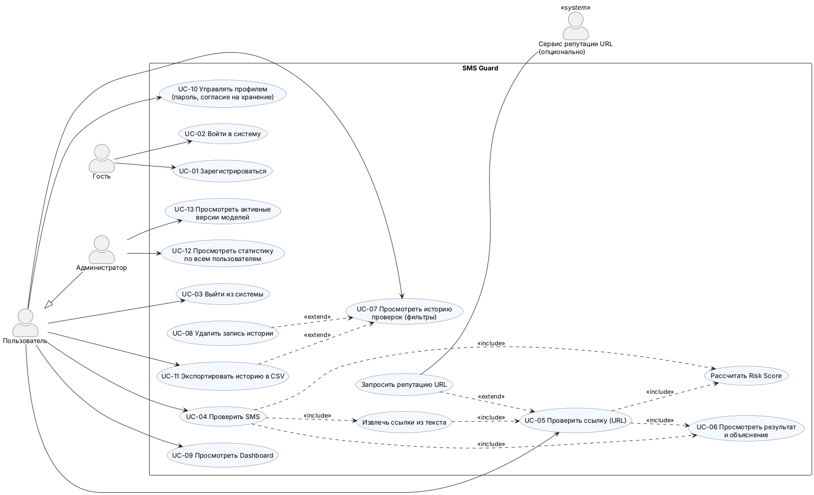

# Задание 1. Анализ предметной области и проектирование системы

**Проект:** SMS Guard — интеллектуальная система обнаружения мошеннических SMS-сообщений и подозрительных ссылок
**Автор:** Омаров Марлен Еркешович, группа SIS-2304
**Дата:** 31.10.2026
**Версия документа:** 1.0

---

## 1. Введение

### 1.1. Проблема

SMS остаётся каналом, который есть у каждого владельца телефона, не требует установки приложений и вызывает высокое доверие: в SMS приходят коды банков, уведомления служб доставки и госсервисов. Злоумышленники используют это доверие и рассылают сообщения, которые выдают себя за банк, курьерскую службу, госорган или родственника. Такую атаку называют **смишинг** (SMS + phishing).

Типовая мошенническая SMS состоит из двух частей:

1. **Текст с психологическим давлением** — срочность («в течение 24 часов»), страх («карта заблокирована»), выгода («вы выиграли»), авторитет («служба безопасности банка»), секретность («никому не говори»).
2. **Целевое действие** — перейти по ссылке на поддельный сайт, позвонить на номер, перевести деньги или назвать код из SMS.

Поэтому система, которая анализирует только текст или только ссылку, пропускает часть атак: текст без ссылки («назовите код из SMS») опасен сам по себе, а безобидный на вид текст может содержать ссылку на фишинговый домен.

### 1.2. Почему нужен ML-подход

| Подход | Ограничение |
| :--- | :--- |
| Чёрные списки номеров и доменов | Мошенники меняют номера и регистрируют новые домены быстрее, чем обновляются списки |
| Ручные правила по ключевым словам | Легко обходятся заменой букв (`b@nk`, `fr33`), не покрывают новые формулировки |
| Проверка самим пользователем | Рядовой пользователь не разбирает структуру URL: поддомены, Punycode, сокращатели |

Модели машинного обучения выявляют статистические закономерности в тексте (слова, N-граммы, символьные N-граммы) и в структуре URL (длина, поддомены, спецсимволы, ключевые слова) и обобщают их на сообщения, которых не было в обучающих данных. В SMS Guard ML-модели дополняются словарём правил социальной инженерии, что даёт объяснимый результат.

### 1.3. Границы системы

* Система **рекомендательная**: оценивает вероятность угрозы, но не гарантирует безопасность.
* URL анализируется **только как строка**: ссылки не открываются, страницы не загружаются, редиректы не отслеживаются.
* SMS-модель обучается на англоязычном наборе UCI SMS Spam Collection; для русского и казахского языков ML-оценка помечается как ненадёжная, пока не подтверждена тестом на собственном наборе (Recall ≥ 0,80).

---

## 2. Категории угроз

Ниже описаны 8 категорий смишинга. Все примеры **искусственные**: номера, суммы и ссылки вымышлены, ссылки используют только зарезервированные домены (`.example`, `.test`, `example.com`).

Обозначения признаков социальной инженерии: **С** — срочность, **Ст** — страх, **А** — авторитет, **В** — выгода, **Сек** — секретность.

### 2.1. Поддельный банк (фишинг учётных данных)

* **Схема.** Сообщение от имени банка просит «подтвердить данные» или «обновить приложение» по ссылке. Ссылка ведёт на копию страницы входа в интернет-банк, введённые логин, пароль и данные карты уходят злоумышленнику.
* **Пример:** «Kaspi: обнаружена попытка входа с нового устройства. Если это не вы, подтвердите личность: http://kaspi-secure-login.example/verify»
* **Признаки СИ:** А (имя банка), Ст (чужой вход), С (неявно — «если это не вы»).
* **Технические признаки:** название бренда в домене, который не принадлежит бренду; слова `secure`, `login`, `verify` в URL; HTTP без HTTPS.

### 2.2. «Блокировка карты»

* **Схема.** Пользователя пугают блокировкой карты или счёта и требуют срочно перейти по ссылке или позвонить на «горячую линию», где «оператор» выманивает данные карты.
* **Пример:** «Ваша карта *4417 заблокирована из-за подозрительной операции! Для разблокировки срочно позвоните: +7 700 000 00 00»
* **Признаки СИ:** Ст (блокировка), С («срочно»), А (банковская терминология).
* **Технические признаки:** слова «заблокирована», «разблокировка»; номер телефона, не являющийся официальным номером банка; восклицательные знаки.

### 2.3. Выигрыш / приз

* **Схема.** Сообщают о выигрыше в розыгрыше, в котором человек не участвовал. Для получения приза нужно оплатить «комиссию» или «доставку» либо ввести данные карты.
* **Пример:** «Поздравляем! Ваш номер выиграл iPhone 17 в акции оператора. Оплатите доставку 990 тг до конца дня: http://prize-win.test/claim»
* **Признаки СИ:** В (приз), С («до конца дня»).
* **Технические признаки:** слова «поздравляем», «выиграл», «приз»; сумма с валютой; подозрительная доменная зона.

### 2.4. Служба доставки

* **Схема.** От имени почты или курьерской службы сообщают, что посылка задержана из-за «неполного адреса» или «таможенного сбора». По ссылке — форма оплаты небольшой суммы, на деле крадутся данные карты.
* **Пример:** «Казпочта: ваша посылка ожидает оплаты таможенного сбора 350 тг. Оплатите в течение 48 часов, иначе посылка вернётся отправителю: http://post-delivery-pay.example»
* **Признаки СИ:** А (название службы), С (срок 48 часов), Ст (возврат посылки).
* **Технические признаки:** слова `delivery`, `pay` в домене; небольшая сумма; срок.

### 2.5. «Родственник в беде»

* **Схема.** Сообщение якобы от сына, дочери или другого родственника с нового номера: попал в беду, срочно нужны деньги, просит никому не говорить. Ссылки обычно нет, поэтому атаку видно только по тексту.
* **Пример:** «Мама, это я, пишу с чужого номера. У меня проблемы, срочно переведи 50 000 на этот номер, потом всё объясню. Никому не говори.»
* **Признаки СИ:** С («срочно»), Ст (проблемы у близкого), Сек («никому не говори»).
* **Технические признаки:** обращение к родственнику, просьба о переводе, сумма, «новый номер»; отсутствие URL.

### 2.6. Запрос кода из SMS

* **Схема.** «Сотрудник банка» или «служба безопасности» просит продиктовать код из SMS — якобы для отмены операции. На самом деле код подтверждает вход или перевод, который инициирует мошенник. Это одна из самых опасных категорий: одного кода достаточно для кражи денег.
* **Пример:** «Служба безопасности банка: назовите код из SMS оператору, чтобы отменить подозрительный перевод на 120 000 тг.»
* **Признаки СИ:** А (служба безопасности), Ст (подозрительный перевод), С (неявно).
* **Технические признаки:** фразы «назовите код», «сообщите код», «код из SMS». В системе такая группа (`CODE_REQUEST`) повышает Risk Score минимум до 70.

### 2.7. Поддельные госуслуги и штрафы

* **Схема.** Сообщение от имени портала госуслуг, налоговой или дорожной полиции о неоплаченном штрафе, задолженности или «положенной выплате». Ссылка ведёт на поддельный портал оплаты.
* **Пример:** «eGov: на ваше имя выписан штраф 15 000 тг. При неоплате в течение 3 дней сумма удвоится. Оплатить со скидкой 50%: http://egov-fines.test/pay»
* **Признаки СИ:** А (госорган), Ст (удвоение штрафа), С (3 дня), В (скидка).
* **Технические признаки:** название госсервиса в домене, который не является официальным; `pay` в пути; подозрительная зона.

### 2.8. Инвестиционное мошенничество

* **Схема.** Предлагают «гарантированный доход» от инвестиций, криптовалюты или «секретной платформы». Цель — заманить на поддельную инвестиционную площадку, где человек вносит деньги, которые невозможно вывести.
* **Пример:** «Доход от 300 000 тг в неделю без вложений опыта! Платформа с ИИ-трейдингом, осталось 5 мест. Регистрация: bit.ly/invest-ai-test»
* **Признаки СИ:** В (высокий доход), С («осталось 5 мест»).
* **Технические признаки:** сокращатель ссылки (скрывает реальный домен); слова «доход», «гарантированно», «без вложений».

### 2.9. Сводная таблица категорий

| № | Категория | Срочность | Страх | Авторитет | Выгода | Секретность | Обычно есть URL |
| :-: | :--- | :-: | :-: | :-: | :-: | :-: | :-: |
| 1 | Поддельный банк | ● | ● | ● | | | да |
| 2 | Блокировка карты | ● | ● | ● | | | иногда (часто телефон) |
| 3 | Выигрыш / приз | ● | | | ● | | да |
| 4 | Служба доставки | ● | ● | ● | | | да |
| 5 | Родственник в беде | ● | ● | | | ● | нет |
| 6 | Запрос кода из SMS | ● | ● | ● | | | нет |
| 7 | Госуслуги / штрафы | ● | ● | ● | ● | | да |
| 8 | Инвестиции | ● | | | ● | | да (часто сокращатель) |

**Вывод для проектирования.** В 3 из 8 категорий ссылка обычно отсутствует, значит текстовый анализ обязателен. В 6 из 8 категорий есть ссылка, значит нужен отдельный URL-анализ. Срочность присутствует во всех категориях — это самый частый признак, но сам по себе он не означает мошенничество (легитимные уведомления тоже бывают срочными), поэтому решение принимается по совокупности признаков.

---

## 3. Анализ аналогов

| Критерий | Встроенные спам-фильтры смартфонов (Google Messages, iOS) | Google Safe Browsing | VirusTotal | Антиспам операторов связи |
| :--- | :--- | :--- | :--- | :--- |
| **Назначение** | Автоматически помечать или скрывать спам в приложении сообщений | Проверка URL по спискам опасных ресурсов (фишинг, вредоносное ПО) | Проверка файла или URL сразу многими антивирусными движками и сканерами | Фильтрация массовых рассылок на стороне сети до доставки абоненту |
| **Что анализирует** | Текст, отправителя, поведенческие сигналы | Только URL (сравнение с базой) | URL, файлы, домены, IP | Отправителя, объём и шаблоны рассылки |
| **Сильные стороны** | Работает автоматически, без действий пользователя; учитывает репутацию отправителя | Огромная, постоянно обновляемая база; встроен в браузеры | Агрегирует мнения десятков движков; подробный отчёт | Блокирует рассылку целиком, до того как SMS дойдёт до людей |
| **Ограничения** | Не объясняет решение; набор функций зависит от платформы и региона; нельзя проверить пересланный текст вручную | Не видит новые домены, которых ещё нет в базе; не анализирует текст SMS | Не анализирует текст SMS; бесплатный публичный API строго ограничен по частоте запросов; новые домены часто ещё «чистые» | Непрозрачен для пользователя; пропускает адресные и малые рассылки; нет проверки «по запросу» |
| **Объяснение результата** | Нет | Только категория угрозы | Список сработавших движков | Нет |
| **Учёт казахского/русского языка** | Зависит от платформы | Не применимо (URL) | Не применимо (URL) | Зависит от оператора |

### Чем SMS Guard отличается

1. **Совместный анализ** текста и ссылок в одном отчёте — ни один из аналогов не делает этого для пересланного пользователем сообщения.
2. **Объяснимость:** причины решения на русском языке («Используется IP-адрес вместо доменного имени», «Сообщение требует назвать код из SMS»).
3. **Структурный анализ URL без обращения к сети** — работает и для новых доменов, которых ещё нет в базах репутации.
4. **История и статистика** проверок для пользователя.

Аналоги не заменяются, а дополняются: Google Safe Browsing может подключаться как необязательный внешний источник (ФТ-3.11), но не заменяет собственную URL-модель.

---

## 4. Целевая аудитория и роли

### 4.1. Целевая аудитория

| Группа | Потребность |
| :--- | :--- |
| Обычные пользователи смартфонов, в том числе пожилые и их родственники | Быстро понять, можно ли доверять полученному сообщению |
| Студенты и сотрудники организаций | Проверить подозрительное письмо/SMS перед переходом по ссылке |
| Специалисты поддержки и ИБ небольших организаций | Разобрать присланный пользователем пример и показать объяснение |

### 4.2. Роли

| Роль | Описание | Права |
| :--- | :--- | :--- |
| **Гость** | Неавторизованный посетитель | Регистрация, вход. Доступа к проверке и истории нет (ФТ-1.6) |
| **Пользователь** | Зарегистрированный пользователь | Проверка SMS и URL, просмотр результата, своя история, свой Dashboard, профиль, согласие на хранение текстов, экспорт CSV |
| **Администратор** | Пользователь с флагом `is_staff` | Всё, что может пользователь, + агрегированная статистика по всем пользователям **без текстов чужих SMS** (ФТ-1.9), просмотр активных версий моделей |

---

## 5. Диаграмма вариантов использования

Исходный код диаграммы — `docs/diagrams/use_case.puml` (PlantUML), изображение — `docs/diagrams/use_case.png`.

### 5.1. Перечень прецедентов

| Код | Прецедент | Актор | Связанные требования |
| :--- | :--- | :--- | :--- |
| UC-01 | Зарегистрироваться | Гость | ФТ-1.1, ФТ-1.2, ФТ-1.4 |
| UC-02 | Войти в систему | Гость | ФТ-1.3, ФТ-1.8 |
| UC-03 | Выйти из системы | Пользователь | ФТ-1.5 |
| UC-04 | Проверить SMS | Пользователь | ФТ-2.1 – ФТ-2.8, НФТ-1, НФТ-6 |
| UC-05 | Проверить ссылку (URL) | Пользователь | ФТ-3.1 – ФТ-3.10 |
| UC-06 | Просмотреть результат и объяснение | Пользователь | ФТ-1.7, раздел 2.5 ТЗ |
| UC-07 | Просмотреть историю проверок | Пользователь | раздел 2.7 ТЗ |
| UC-08 | Удалить запись истории | Пользователь | ФТ-1.7, раздел 2.7 ТЗ |
| UC-09 | Просмотреть Dashboard | Пользователь | раздел 2.6 ТЗ, НФТ-2 |
| UC-10 | Управлять профилем | Пользователь | раздел 2.7 ТЗ (согласие на хранение текста) |
| UC-11 | Экспортировать историю в CSV | Пользователь | раздел 2.7 ТЗ |
| UC-12 | Просмотреть статистику по всем пользователям | Администратор | ФТ-1.9 |
| UC-13 | Просмотреть активные версии моделей | Администратор | раздел 2.4 ТЗ |

Вспомогательные прецеденты: «Извлечь ссылки из текста» и «Рассчитать Risk Score» включаются (`<<include>>`) в проверку SMS; «Запросить репутацию URL» расширяет (`<<extend>>`) проверку ссылки и выполняется, только если подключён внешний сервис.

### 5.2. Сценарий основного прецедента UC-04 «Проверить SMS»

* **Предусловие:** пользователь авторизован, модели загружены.
* **Основной поток:**
  1. Пользователь вставляет текст SMS и нажимает «Проверить сообщение».
  2. Система проверяет длину (1–1000 символов) и лимит запросов (30 в минуту).
  3. Система определяет язык и извлекает до 3 ссылок.
  4. Текст нормализуется и передаётся в SMS-модель → $P_{sms}$.
  5. Словарь правил возвращает сработавшие группы социальной инженерии.
  6. Каждая ссылка проверяется URL-моделью → $P_{url}$.
  7. Модуль риска рассчитывает Risk Score, уровень, категорию, причины и рекомендацию.
  8. Результат сохраняется в истории (полный текст — только при согласии) и показывается пользователю.
* **Альтернативные потоки:**
  * 2a. Пустой или слишком длинный текст → сообщение об ошибке рядом с полем.
  * 2b. Превышен лимит → ответ 429 и сообщение «Слишком много проверок, попробуйте через минуту».
  * 3a. Язык не английский → предупреждение о сниженной надёжности ML-оценки текста.
  * 4a. Модель не загружена → ответ 503 «Анализ временно недоступен».
* **Постусловие:** запись проверки сохранена в БД и учтена в Dashboard.

---

## 6. Таблица требований

Приоритет по методу **MoSCoW**: **M** (Must) — без этого система не принимается; **S** (Should) — важно, но система работает и без этого; **C** (Could) — желательно при наличии времени; **W** (Won't) — не реализуется в этой версии.

### 6.1. Функциональные требования

| Код | Требование | Модуль | Приоритет |
| :--- | :--- | :--- | :-: |
| ФТ-1.1 | Регистрация по логину (3–30 символов, латиница, цифры), e-mail и паролю (≥ 8 символов, буквы и цифры) | Авторизация | M |
| ФТ-1.2 | Уникальность логина и e-mail, понятная ошибка при повторе | Авторизация | M |
| ФТ-1.3 | Вход по логину и паролю; после 5 неудачных попыток — пауза ≥ 60 с | Авторизация | S |
| ФТ-1.4 | Хранение паролей только как хеш с солью (PBKDF2/bcrypt/Argon2) | Авторизация | M |
| ФТ-1.5 | Выход уничтожает сессию | Авторизация | M |
| ФТ-1.6 | Защищённые страницы доступны только после входа | Авторизация | M |
| ФТ-1.7 | Пользователь видит только свои проверки (чужая запись → 404/403) | Авторизация | M |
| ФТ-1.8 | Cookie HttpOnly, SameSite=Lax, Secure при HTTPS; CSRF-токен во всех POST-формах | Авторизация | M |
| ФТ-1.9 | Администратор видит агрегированную статистику без текстов чужих SMS | Авторизация | S |
| ФТ-2.1 | Поле SMS 1–1000 символов; пустой ввод и пробелы отклоняются | Анализ SMS | M |
| ФТ-2.2 | Определение языка (`ru`, `kk`, `en`, `other`) | Анализ SMS | S |
| ФТ-2.3 | Очистка и нормализация, замена сущностей токенами | Анализ SMS | M |
| ФТ-2.4 | TF-IDF той же векторизацией, что при обучении (единый pipeline) | Анализ SMS | M |
| ФТ-2.5 | Словарь правил СИ, ≥ 6 групп | Анализ SMS | M |
| ФТ-2.6 | Классификация ML-моделью с вероятностью $P_{sms}$ | Анализ SMS | M |
| ФТ-2.7 | Автоматическая передача найденных URL (до 3) в модуль ссылок | Анализ SMS | M |
| ФТ-2.8 | Предупреждение о сниженной надёжности для неподдерживаемого языка | Анализ SMS | S |
| ФТ-3.1 | Проверка формата URL (http/https/без схемы, до 2048 символов) | Анализ URL | M |
| ФТ-3.2 | Извлечение ≥ 20 числовых признаков | Анализ URL | M |
| ФТ-3.3 | Обнаружение IP-адреса вместо домена | Анализ URL | M |
| ФТ-3.4 | Подсчёт поддоменов, точек, дефисов, цифр, спецсимволов | Анализ URL | M |
| ФТ-3.5 | Проверка HTTPS, нестандартного порта, `@`, двойного `//` | Анализ URL | M |
| ФТ-3.6 | Распознавание URL-сокращателей (≥ 15 сервисов) | Анализ URL | M |
| ФТ-3.7 | Подозрительные ключевые слова в URL | Анализ URL | M |
| ФТ-3.8 | Punycode, смешение алфавитов, сходство с брендом (Левенштейн < 2) | Анализ URL | S |
| ФТ-3.9 | Классификация URL ML-моделью, категории SAFE/SUSPICIOUS/DANGEROUS | Анализ URL | M |
| ФТ-3.10 | Ссылки в результатах — неактивный текст, домен выделен | Анализ URL | M |
| ФТ-3.11 | Запрос к внешнему сервису репутации с таймаутом 3 с | Анализ URL | C |
| ФТ-4.1 | SMS-модель: TF-IDF + классификатор, сравнение ≥ 3 алгоритмов | Интеллектуальный модуль | M |
| ФТ-4.2 | URL-модель: числовые признаки + классификатор, сравнение ≥ 2 алгоритмов | Интеллектуальный модуль | M |
| ФТ-4.3 | Сохранение моделей в `joblib` с метаданными (версия, дата, признаки, метрики, порог) | Интеллектуальный модуль | M |
| ФТ-4.4 | Загрузка моделей один раз при старте приложения | Интеллектуальный модуль | M |
| ФТ-5.1 | Risk Score 0–100 и уровень (низкий/средний/высокий) | Оценка риска | M |
| ФТ-5.2 | Веса и пороги в `risk_config.yaml`, подбор на валидации | Оценка риска | M |
| ФТ-5.3 | Список причин (≥ 1) и рекомендация для каждого результата | Оценка риска | M |
| ФТ-5.4 | Обязательный дисклеймер о вероятностном характере оценки | Оценка риска | M |
| ФТ-6.1 | Dashboard: счётчики SMS/URL и категорий | Dashboard | M |
| ФТ-6.2 | Диаграмма распределения категорий | Dashboard | M |
| ФТ-6.3 | Линейный график проверок по дням за 30 дней | Dashboard | S |
| ФТ-6.4 | Распределение уровней риска | Dashboard | S |
| ФТ-6.5 | Топ-5 признаков социальной инженерии | Dashboard | S |
| ФТ-6.6 | Таблица 5–10 последних проверок со ссылкой на результат | Dashboard | M |
| ФТ-7.1 | Сохранение каждой проверки со всеми полями (дата, тип, категория, риск, вероятности, версии моделей) | История | M |
| ФТ-7.2 | Пагинация по 20 записей, сортировка по дате (новые сверху) | История | M |
| ФТ-7.3 | Фильтры: даты, тип, категория, уровень риска | История | S |
| ФТ-7.4 | Просмотр подробного результата и удаление своей записи | История | M |
| ФТ-7.5 | Полный текст SMS — только при согласии; иначе маскированная версия | История | M |
| ФТ-7.6 | Экспорт истории в CSV | История | C |
| ФТ-8.1 | Загрузка файла с пачкой SMS для пакетной проверки | Анализ SMS | W |
| ФТ-8.2 | Мобильное приложение с перехватом входящих SMS | — | W |

> Требования ФТ-4.x – ФТ-7.x сформулированы по разделам 2.4–2.7 ТЗ, в которых требования не пронумерованы; коды присвоены в этом документе. ФТ-8.x зафиксированы как явно исключённые из текущей версии.

### 6.2. Нефункциональные требования

| Код | Группа | Требование | Приоритет |
| :--- | :--- | :--- | :-: |
| НФТ-1 | Производительность | Анализ одного SMS (до 3 URL) ≤ 500 мс без внешних API | M |
| НФТ-2 | Производительность | Загрузка Dashboard при 1000 записях ≤ 2 с | S |
| НФТ-3 | Производительность | Повторная отправка формы не создаёт дубликат | S |
| НФТ-4 | Безопасность | Запросы к БД только через ORM / параметризованные запросы | M |
| НФТ-5 | Безопасность | Экранирование пользовательского ввода при выводе (XSS) | M |
| НФТ-6 | Безопасность | Не более 30 проверок в минуту на пользователя (429) | M |
| НФТ-7 | Безопасность | Секреты в `.env`, не в репозитории; `DEBUG=False` в демо-сборке | M |
| НФТ-8 | Безопасность | Загрузка файлов (если есть): `.txt`/`.csv`, ≤ 1 МБ, вне веб-корня | C |
| НФТ-9 | Приватность | Тексты SMS не пишутся в логи | M |
| НФТ-10 | Удобство | Адаптивная вёрстка 360 / 768 / 1366 px | S |
| НФТ-11 | Удобство | Ошибки ввода — текстом на русском рядом с полем | M |
| НФТ-12 | Надёжность | Некорректный ввод не вызывает ошибку 500 | M |
| НФТ-13 | Надёжность | Логи в `logs/app.log` с ротацией | M |
| НФТ-14 | Надёжность | При отсутствии файла модели приложение стартует и сообщает о недоступности анализа | S |
| НФТ-15 | Сопровождаемость | Покрытие `ml/` и `risk/` тестами ≥ 60% строк | S |

### 6.3. Итог по приоритетам

| Приоритет | ФТ | НФТ | Всего |
| :--- | :-: | :-: | :-: |
| Must | 37 | 9 | 46 |
| Should | 9 | 5 | 14 |
| Could | 2 | 1 | 3 |
| Won't | 2 | 0 | 2 |

---

## 7. Выводы

1. Описано 8 категорий смишинга; в каждой есть искусственный пример и признаки социальной инженерии. Самый частый признак — срочность (8 из 8), но он не достаточен для решения, поэтому оценка строится по совокупности признаков.
2. В трёх категориях из восьми ссылка обычно отсутствует, в шести — присутствует. Отсюда архитектурное решение: две независимые модели (текст и URL) и модуль риска, который объединяет их с правилами.
3. Существующие решения (спам-фильтры смартфонов, Google Safe Browsing, VirusTotal, фильтры операторов) либо не анализируют текст, либо не объясняют решение, либо не дают проверить сообщение по запросу. SMS Guard закрывает эту нишу и может использовать внешние сервисы как дополнительный источник.
4. Определены три роли (Гость, Пользователь, Администратор) и 13 прецедентов.
5. Составлена таблица из 50 функциональных и 15 нефункциональных требований с кодами и приоритетами MoSCoW; она будет основой матрицы трассировки в задании 18.
