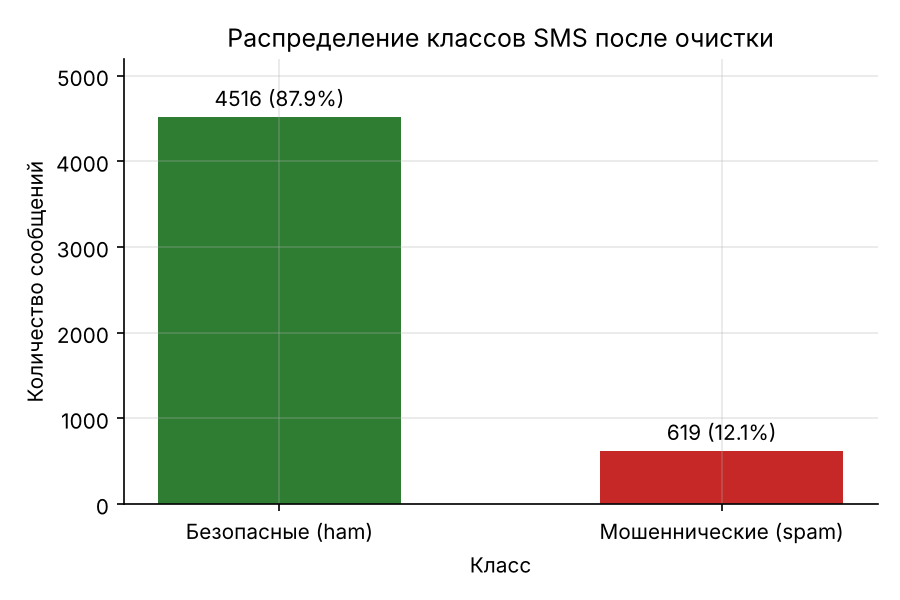
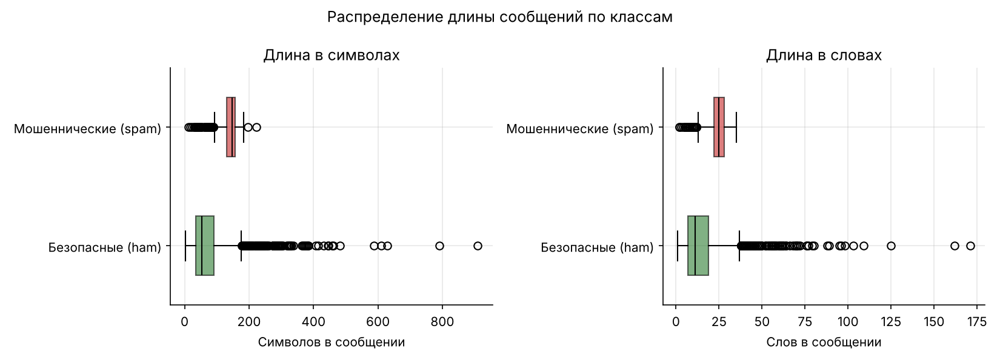
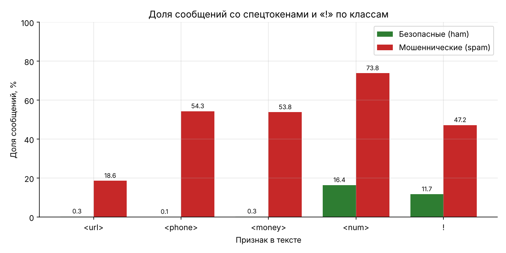
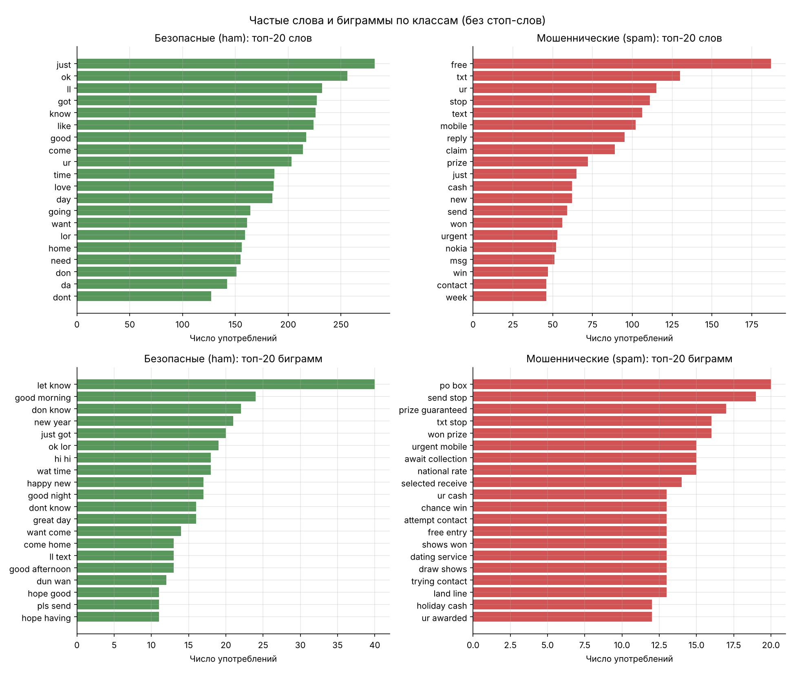

# Задание 5. Исследовательский анализ SMS-данных (EDA)

**Автор:** Омаров Марлен Еркешович, SIS-2304

Полный анализ с кодом — `notebooks/01_eda_sms.ipynb`. Данные — `data/processed/sms_clean.csv`
(5135 сообщений после очистки в задании 4).

**Корректность.** Анализ выполнен на всём очищенном наборе до разбиения на выборки и до обучения.
По его результатам не подбираются параметры моделей и порог; он только формирует гипотезы для признаков.

## Графики

| Файл | Содержание |
| :--- | :--- |
| `docs/figures/05_class_distribution.png` | Распределение классов (количество и процент) |
| `docs/figures/05_length_boxplot.png` | Длина сообщений в символах и словах по классам (boxplot) |
| `docs/figures/05_length_hist.png` | Гистограмма длины в символах по классам |
| `docs/figures/05_top_words_bigrams.png` | Топ-20 слов и биграмм для каждого класса (без стоп-слов) |
| `docs/figures/05_markers_by_class.png` | Доля сообщений с `<url>`, `<phone>`, `<money>`, `<num>`, «!» по классам |

## Сводные числа

| Показатель | ham | spam |
| :--- | --: | --: |
| Сообщений | 4516 (87,9%) | 619 (12,1%) |
| Средняя / медианная длина, символов | 70,9 / 53 | 137,5 / 148 |
| Средняя длина, слов | 14,2 | 23,7 |
| Доля с длиной 120–160 символов | 12,3% | 72,7% |
| Доля с `<url>` | 0,3% | 18,6% |
| Доля с `<phone>` | 0,1% | 54,3% |
| Доля с `<money>` | 0,3% | 53,8% |
| Доля с «!» | 11,7% | 47,2% |
| Доля заглавных букв | 7,7% | 16,6% |
| Доля со словом free | 1,2% | 23,1% |

## Выводы

1. **Сильный дисбаланс классов.** После очистки 4516 безопасных (87,9%) и 619 мошеннических (12,1%) сообщений, соотношение 7,3 : 1. Модель, которая на всё отвечает «ham», получит Accuracy 87,9% и не найдёт ни одного мошенничества. **Как учитываем:** стратифицированное разбиение 70/15/15 (задание 6), `class_weight='balanced'` в моделях, основные метрики — Precision, Recall, F1/F2 и PR-AUC для класса spam, а не Accuracy.
2. **Мошеннические SMS почти вдвое длиннее.** Средняя длина spam — 137,5 символа против 70,9 у ham (медиана 148 против 53), в словах — 23,7 против 14,2. 72,7% spam имеют длину 120–160 символов (у ham — 12,3%): рассылки заполняют одну SMS почти до лимита в 160 символов. **Гипотеза:** длина сообщения — полезный ручной признак.
3. **Длина spam однородна, ham — нет.** Стандартное отклонение длины у spam 30,1 символа, у ham — 56,6; самое длинное spam — 223 символа, ham — 910. Все 57 сообщений длиннее 250 символов — ham; из 1549 сообщений короче 40 символов spam только 8.
4. **Контакты и суммы — самый сильный сигнал.** Телефон (`<phone>`) есть в 54,3% spam и в 0,1% ham, сумма с валютой (`<money>`) — 53,8% против 0,3%, ссылка (`<url>`) — 18,6% против 0,3%. Хотя бы один из трёх токенов есть в 83,2% spam и лишь в 0,66% ham. **Гипотеза:** признаки «есть `<url>`», «есть `<money>`» сильно разделяют классы. При этом 104 spam (16,8%) не содержат ни одного из них — значит, без анализа слов не обойтись.
5. **Признаки давления.** «!» встречается в 47,2% spam и 11,7% ham (в 4 раза чаще), в среднем 0,70 против 0,18 знака на сообщение. Доля заглавных букв в spam 16,6% против 7,7% (`URGENT`, `WINNER`, `FREE`). **Гипотеза:** число «!» и доля заглавных — полезные ручные признаки; поэтому доля заглавных считается по исходному тексту (`text_raw`), до приведения к нижнему регистру.
6. **Лексика spam — выигрыш и призыв к действию.** Топ-слова spam: free (187), txt (130), stop (111), text (106), mobile (102), reply (95), claim (89), prize (72), cash (62), won (56), urgent (53). Слово free есть в 23,1% spam и 1,2% ham. Биграммы spam: prize guaranteed, won prize, urgent mobile, chance win, ur awarded — это группы «выигрыш/приз» и «срочность» из словаря правил. Лексика ham — разговорная: just, ok, know, love, home, good morning.
7. **Сленг и сокращения в обоих классах.** ur (spam — 115, ham — 203), txt, lor, da, dont, wat: короткие и намеренно искажённые формы. **Гипотеза:** символьные N-граммы (`char_wb`, 3–5) устойчивее к таким формам и искажениям (`fr33`, `b@nk`), чем словарь слов.
8. **Ограничение набора.** Ссылки есть только в 18,6% spam: это спам до 2012 года (короткие номера, призы, подписки), а современный смишинг (поддельный банк, доставка) почти всегда содержит ссылку. Поэтому ссылки анализируются отдельной URL-моделью (задания 9–11), а на русском и казахском текстовая модель проверяется отдельно (задание 8).

**Итог для задания 6:** TF-IDF по словам и биграммам + символьные N-граммы + ручные признаки: длина, доля заглавных, число «!», наличие `<url>`, `<money>`, `<phone>`, число сработавших групп словаря социальной инженерии.

