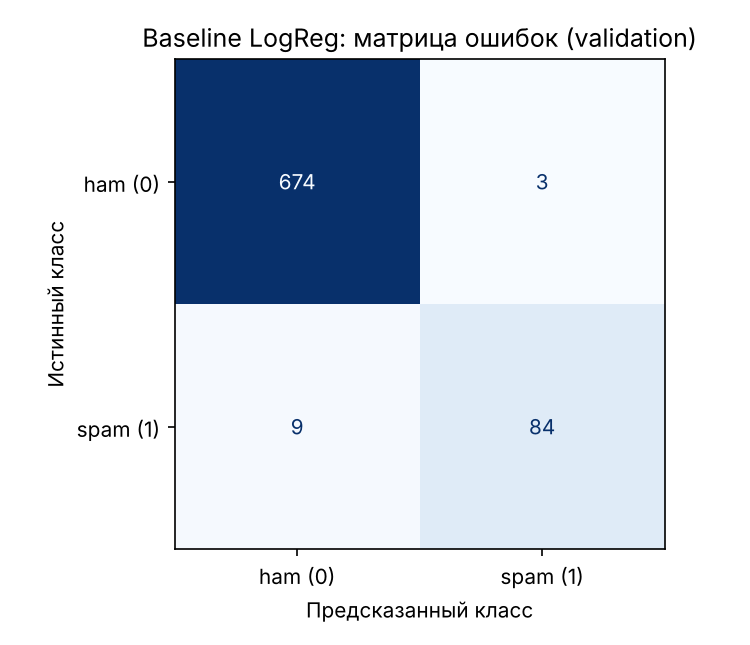

# Задание 7. Обучение первой ML-модели (baseline)

**Автор:** Омаров Марлен Еркешович, SIS-2304

Ноутбук: `notebooks/03_baseline_sms.ipynb`. Тот же цикл без ноутбука: `python -m ml.train_baseline`.
Функция предсказания: `ml/predictor.py::predict_sms`. Модель: `ml/artifacts/sms_baseline.joblib`
(в репозиторий не добавляется, создаётся одной из команд выше), метаданные: `ml/artifacts/sms_baseline_meta.json`.

## 1. Модель

```python
Pipeline([
    ("features", build_vectorizer()),   # TF-IDF слова (1–2) + TF-IDF символы char_wb (3–5) + 8 ручных признаков
    ("clf", LogisticRegression(class_weight="balanced", max_iter=1000, random_state=42)),
])
```

Обучение — на train (3594 SMS), все метрики — на validation (770 SMS). Тестовая выборка не использовалась.
Порог классификации — 0,5.

## 2. Метрики на validation

| Метрика | Значение |
| :--- | --: |
| Accuracy | 0,9844 |
| Precision (мошенничество) | 0,9655 |
| Recall (мошенничество) | 0,9032 |
| F1 (мошенничество) | 0,9333 |
| F1 (macro) | 0,9623 |
| ROC-AUC | 0,9939 |
| PR-AUC | 0,9796 |
| Время обучения | ≈ 1 с |
| Время предсказания одного SMS | ≈ 4 мс |

Матрица ошибок (validation): TN = 674, FP = 3, FN = 9, TP = 84.



## 3. Разбор ошибок

**Комментарии к ошибкам.**

*Пропущенные мошеннические SMS (FN, всего 9 из 93 = 9,7%):*

| id | $P_{sms}$ | Почему модель ошиблась |
| --: | --: | :--- |
| 2775 | 0,041 | Загадка из платной подписки, написанная как обычный вопрос. Нет телефона, суммы, ссылки и призыва к действию; по одному тексту её не отличить от личного сообщения (пограничная разметка). |
| 1431 | 0,067 | Частное объявление «For sale — dartboard» без контакта и цены. Лексика нейтральная, сильных признаков (`<phone>`, `<money>`) нет. |
| 5373 | 0,126 | Реклама сервиса знакомств, замаскированная под личное сообщение: первое лицо, вопрос к собеседнику, разговорный стиль. |
| 4950 | 0,245 | Есть слово free, но нет номера, ссылки и суммы; вежливое обращение «Hi this is Amy» снижает вероятность. |
| 2771 | 0,267 | Промо-акция Burger King: слово winner есть, но названия брендов и спортивная лексика в обучающем спаме почти не встречались. |

Общая причина: все пропуски не содержат `<phone>`, `<money>` и `<url>` — самых сильных признаков спама
(в EDA таких spam-сообщений было 16,8%). Модель на них опирается сильно, и спам без контактов «проседает» ниже порога 0,5.
При этом ROC-AUC = 0,994: по вероятности такие сообщения всё же ранжируются выше большинства ham, поэтому снижение
порога (задание 8) может поднять Recall ценой небольшого числа ложных тревог.

*Ложные тревоги (FP).* На validation их всего **3** (из 677 ham — 0,44%), поэтому ниже разобраны все три, а для пяти
примеров добавлены два безопасных SMS с наибольшей вероятностью ниже порога («почти ошибки»):

| id | $P_{sms}$ | Ошибка? | Почему модель ошиблась |
| --: | --: | :-: | :--- |
| 3739 | 0,609 | FP | Предупреждение **о** мошенничестве: «mobile», «type #», «sim card», «verified», «confirmd». Лексика мошеннической схемы та же, смысл — противоположный. |
| 2280 | 0,599 | FP | Две суммы в долларах ($700, $900) → токен `<money>`, который встречается лишь в 0,3% ham. |
| 181 | 0,508 | FP | Опрос о качестве обслуживания: «Reply … Toll Free with Yes or No» — типичный призыв к ответу и слово free, как в спаме. |
| 3850 | 0,429 | нет | Подпись SMS-шлюза «sent via fullonsms.com» превращается в `<url>`. |
| 2409 | 0,380 | нет | Длинная «цепочка»-загадка с нумерацией и призывом «Reply With Reason» — стиль массовой рассылки. |

Общая причина: легитимные сообщения с суммами, ссылками и призывом «reply / free». Такие ошибки уменьшаются
порогом, учитывающим Precision, и объяснением результата (пользователь видит, какие признаки сработали).

## 4. Выводы

1. Baseline Logistic Regression на validation: Precision (мошенничество) 0,966, Recall 0,903, F1 0,933, ROC-AUC 0,994,
   PR-AUC 0,980; ошибок 12 из 770 (9 FN, 3 FP). Recall и F1 уже на уровне ориентира ТЗ (≥ 0,90), но это
   validation, а не test.
2. Главный тип ошибок — пропуск спама без телефона, суммы и ссылки. Резерв улучшения — подбор порога и
   сравнение алгоритмов (задание 8).
3. Модель сохранена вместе с векторизатором (`ml/artifacts/sms_baseline.joblib`, около 0,9 МБ), загружается из
   файла и даёт те же вероятности. Время предсказания одного SMS — несколько миллисекунд, что укладывается
   в требование НФТ-1 (≤ 500 мс на весь анализ).
4. Функция `predict_sms(text)` работает на новом тексте, введённом вручную. На русских примерах модель,
   обученная только на английском, ведёт себя ненадёжно: мошенническое SMS распознано в основном по ссылке
   и ручным признакам, а безопасное «Привет! Встречаемся завтра в 18:00» получило вероятность, близкую к
   порогу. Поэтому для `ru` и `kk` ML-оценка текста пока помечается как ненадёжная; проверка на
   собственном наборе — в задании 8.
