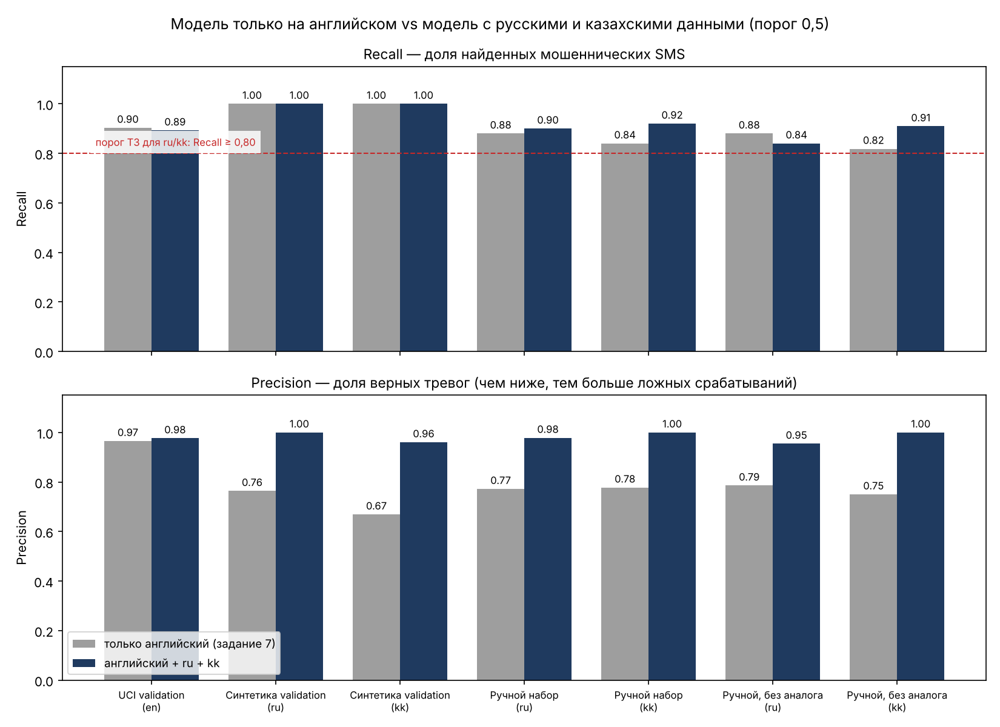

# Многоязычная baseline-модель (английский + русский + казахский)

**Автор:** Омаров Марлен Еркешович, SIS-2304

Дополнение к заданию 7. Ноутбук: `notebooks/04_multilang_sms.ipynb`.
Обучение без ноутбука: `python -m ml.train_baseline --multi` → `ml/artifacts/sms_baseline_multi.joblib`.
Данные: `docs/03b_synthetic_dataset.md`.

## 1. Что сравнивается

| Модель | Обучающие данные | SMS |
| :--- | :--- | --: |
| `en` — baseline задания 7 | UCI train (английский) | 3594 |
| `multi` | UCI train + синтетический ru/kk train | 4852 (en 3594, ru 628, kk 630) |

Pipeline одинаковый: признаки задания 6 (TF-IDF слов + символов + 8 ручных) и Logistic Regression
(`class_weight='balanced'`), порог 0,5. Тестовые выборки (UCI test, синтетический test) не использовались.

**Ручной набор** `custom_ru_kk.csv` (150 SMS) в обучение не входит. Для каждого ручного SMS измерено сходство
с обучающими данными (косинусное сходство символьных TF-IDF). У 76 сообщений есть близкий аналог (сходство ≥ 0,6),
у 74 — нет. Метрики на 74 сообщениях без аналога — самая строгая оценка.

## 2. Результаты

| Набор | Модель | Precision | Recall | F1 | ROC-AUC | FP | FN |
| :--- | :-: | --: | --: | --: | --: | --: | --: |
| UCI validation (en, 770) | en | 0,966 | 0,903 | 0,933 | 0,994 | 3 | 9 |
| | multi | 0,976 | 0,892 | 0,933 | 0,994 | 2 | 10 |
| Синтетика validation (ru, 185) | en | 0,764 | 1,000 | 0,866 | 1,000 | 30 | 0 |
| | multi | 1,000 | 1,000 | 1,000 | 1,000 | 0 | 0 |
| Синтетика validation (kk, 182) | en | 0,669 | 1,000 | 0,802 | 0,999 | 48 | 0 |
| | multi | 0,960 | 1,000 | 0,980 | 1,000 | 4 | 0 |
| Ручной набор (ru, 100) | en | 0,772 | 0,880 | 0,822 | 0,892 | 13 | 6 |
| | multi | 0,978 | 0,900 | 0,938 | 0,997 | 1 | 5 |
| Ручной набор (kk, 50) | en | 0,778 | 0,840 | 0,808 | 0,896 | 6 | 4 |
| | multi | 1,000 | 0,920 | 0,958 | 1,000 | 0 | 2 |
| **Ручной без аналога (ru, 49)** | en | 0,786 | 0,880 | 0,830 | 0,902 | 6 | 3 |
| | **multi** | **0,955** | **0,840** | **0,894** | 0,990 | 1 | 4 |
| **Ручной без аналога (kk, 25)** | en | 0,750 | 0,818 | 0,783 | 0,922 | 3 | 2 |
| | **multi** | **1,000** | **0,909** | **0,952** | 1,000 | 0 | 1 |

## 3. Выводы

1. **Модель только на английском переносится на ru/kk плохо.** Мошенничество она часто находит благодаря ссылкам, суммам и ручным признакам (Recall 0,88 на русском и 0,84 на казахском ручном наборе), но даёт много ложных тревог: Precision 0,77–0,78, на синтетической validation — 30 (ru) и 48 (kk) ложных срабатываний. ROC-AUC на ручном наборе — 0,89–0,90.
2. **Добавление 2000 русских и казахских SMS почти убирает ложные тревоги.** На ручном наборе: русский — Precision 0,978, Recall 0,90, F1 0,938; казахский — Precision 1,00, Recall 0,92, F1 0,958; ROC-AUC 0,997 и 1,00.
3. **Строгая оценка — ручные SMS без близкого аналога в обучении** (74 из 150): русский — Recall 0,84, Precision 0,955; казахский — Recall 0,91, Precision 1,00. Требование ТЗ для заявления поддержки языка (Recall ≥ 0,80) выполнено на validation и ручном наборе; окончательно оно проверяется на test в задании 8.
4. **Качество на английском не ухудшилось:** F1 0,933 у обеих моделей (Recall 0,903 → 0,892, одна дополнительная пропущенная SMS; Precision 0,966 → 0,976).
5. **Оставшиеся ошибки** — 7 пропущенных мошеннических SMS без ссылки («родственник в беде», «запрос кода», ответ с данными карты) и одна реклама со ссылкой. Все 7 пропусков ловит словарь правил, 4 из них — группой `CODE_REQUEST`, которая в модуле риска (задание 13) поднимает Risk Score минимум до 70. Порог классификации подбирается в задании 8.
6. **Ограничения.** Синтетические данные проще реальных: на синтетической validation метрики близки к 1,0, и эти числа нельзя переносить на настоящие SMS. Все ru/kk-сообщения написаны одним автором по одним и тем же схемам. Ручной набор маленький: в казахском без аналога 11 мошеннических SMS, одна ошибка меняет Recall на 9 п. п. Поэтому поддержка русского и казахского заявляется только в пределах этих проверок, с предупреждением в интерфейсе.

## 4. Какая модель используется по умолчанию

`ml/predictor.py::predict_sms` загружает `sms_baseline_multi.joblib`, если он есть, иначе — английскую
`sms_baseline.joblib`.
