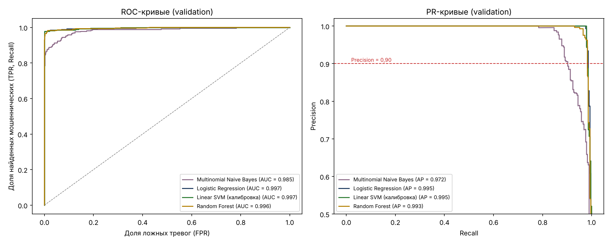
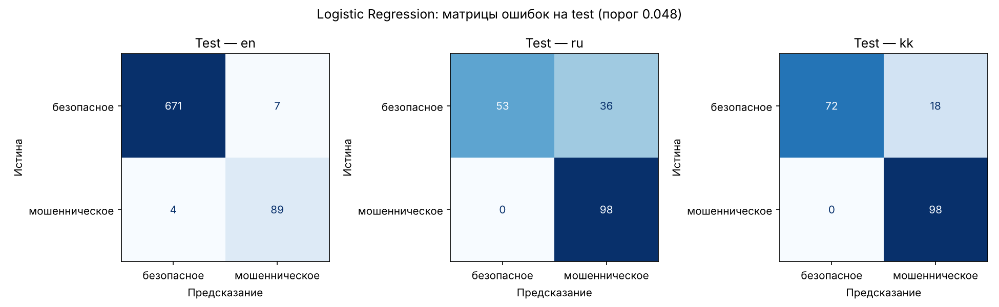

# Задание 8. Сравнение алгоритмов классификации SMS

**Автор:** Омаров Марлен Еркешович, SIS-2304

Ноутбук: `notebooks/05_sms_models.ipynb`. Тот же цикл без ноутбука: `python -m ml.train_sms`.
Итоговая модель: `ml/artifacts/sms_model.joblib` + `sms_model_meta.json` (версия 1.0.0).
Результаты всех моделей: `ml/artifacts/sms_comparison.json`.

## 1. Методика

| Шаг | Как сделано |
| :--- | :--- |
| Данные | UCI train/val/test (английский, задание 6) + синтетический ru/kk-набор (разбиение по шаблонам). train — 4852 SMS, validation — 1137, test — 1146. Ручной набор (150 SMS) — только проверка |
| Алгоритмы | Multinomial NB, Logistic Regression, Linear SVM + `CalibratedClassifierCV`, Random Forest |
| Подбор параметров | `GridSearchCV`, 5 фолдов, метрика F2. Фолды — `StratifiedGroupKFold`: сообщения одного синтетического шаблона не попадают одновременно в обучающий и проверочный фолд |
| Сетки | NB: `alpha` 0,01–1; LR и SVM: `C` 0,01–100; RF: `n_estimators` 200/400, `max_depth` None/60 |
| Порог | На validation: минимальный порог, при котором Precision ≥ 0,90 (Recall при этом максимален) |
| Выбор модели | Максимум F2 на validation при Precision ≥ 0,85; при разнице F2 < 0,005 — более быстрая и интерпретируемая |
| Test | Один раз для выбранной модели; затем переобучение на train + val и сохранение |

**Почему порог подбирается для Precision ≥ 0,90, а не 0,85.** Правило задания (минимальный порог при Precision ≥ 0,85)
опускает Precision ровно до 0,85, что меньше требования раздела 3.4 к SMS-модели (Precision ≥ 0,90). Поэтому целевая
Precision поднята до 0,90; условие задания (≥ 0,85) при этом тоже выполняется.

## 2. Сравнение алгоритмов (validation)

| Алгоритм | Параметры | CV F2 | Порог | Precision | Recall | F1 | F2 | ROC-AUC | PR-AUC | Обучение, с | Предсказание, мс |
| :--- | :--- | --: | --: | --: | --: | --: | --: | --: | --: | --: | --: |
| Multinomial NB | alpha = 0,05 | 0,916 | 1,000 | 0,902 | 0,902 | 0,902 | 0,902 | 0,985 | 0,972 | 23 | 4,5 |
| **Logistic Regression** | **C = 100** | 0,955 | 0,048 | 0,901 | **0,986** | 0,942 | **0,968** | **0,997** | **0,995** | 20 | **4,4** |
| Linear SVM (калибр.) | C = 10 | 0,940 | 0,247 | 0,901 | 0,983 | 0,940 | 0,965 | 0,997 | 0,995 | 22 | 5,3 |
| Random Forest | 400 деревьев, без ограничения глубины | 0,933 | 0,305 | 0,904 | 0,983 | 0,942 | 0,966 | 0,996 | 0,993 | 66 | 80 |

Время обучения — весь `GridSearchCV` (5 фолдов × сетка). Время предсказания — одно SMS за вызов, среднее по 200 SMS.

## 3. Варианты признаков (validation, F2 / PR-AUC)

| Признаки | Naive Bayes | Logistic Regression |
| :--- | :-: | :-: |
| Слова (1–2-граммы) | 0,894 / 0,973 | 0,965 / 0,989 |
| Слова без стоп-слов | **0,935** / 0,979 | 0,965 / 0,944 |
| Слова + символьные n-граммы | 0,871 / 0,966 | 0,965 / 0,995 |
| Слова + символы + 8 ручных признаков | 0,902 / 0,972 | **0,968 / 0,995** |
| Слова + символы + ручные, без стоп-слов | 0,908 / 0,972 | 0,968 / 0,995 |

## 4. Итоговая модель и оценка на test

Выбрана **Logistic Regression, C = 100**, порог **0,048**: лучший F2 и PR-AUC на validation, быстрая (4,4 мс), веса признаков интерпретируемы.

| Набор (порог 0,048) | SMS | Precision | Recall | F1 | F2 | ROC-AUC | TN | FP | FN | TP |
| :--- | --: | --: | --: | --: | --: | --: | --: | --: | --: | --: |
| Test — все языки | 1146 | 0,824 | 0,986 | 0,898 | 0,949 | 0,993 | 796 | 61 | 4 | 285 |
| **Test — en (UCI)** | 771 | **0,927** | **0,957** | **0,942** | 0,951 | 0,993 | 671 | 7 | 4 | 89 |
| Test — ru (синтетика) | 187 | 0,731 | 1,000 | 0,845 | 0,932 | 0,984 | 53 | 36 | 0 | 98 |
| Test — kk (синтетика) | 188 | 0,845 | 1,000 | 0,916 | 0,965 | 0,989 | 72 | 18 | 0 | 98 |
| Ручной набор — ru | 100 | 0,980 | 1,000 | 0,990 | 0,996 | 0,999 | 49 | 1 | 0 | 50 |
| Ручной набор — kk | 50 | 0,926 | 1,000 | 0,962 | 0,984 | 1,000 | 23 | 2 | 0 | 25 |

**Требования раздела 3.4** (Recall ≥ 0,90, Precision ≥ 0,90, F1 ≥ 0,90): на английском test выполнены;
на всём test не выполнены по Precision (0,824) — причины в разделе 5.

После переобучения на train + val (это и есть сохранённая модель), справочно на test: Precision 0,856, Recall 0,990, F1 0,918.

## 5. Анализ ошибок

**Ложные тревоги (61).** 54 из них — синтетические русские и казахские безопасные SMS из шаблонов, которых не было в обучении:

| Категория | FP | Пример |
| :--- | --: | :--- |
| Курьер с номером телефона | 26 | «Курьер Доставка: буду у вас через 20 минут, телефон +7000…» — P = 0,90 |
| Реклама магазина со ссылкой | 13 | «Wildberries: новая коллекция уже в продаже. Подробнее: https://www.example.com/…» |
| Уведомления о переводах и оплате | 13 | «Перевод 10 000 тг от Нурлан успешно зачислен на карту *3562» |
| Баланс номера | 2 | «Баланс вашего номера: 75 000 тг…» |
| Английские (UCI) | 7 | «Tell your friends what you plan to do on Valentines day @ &lt;URL&gt;» |

Модель усвоила из английского набора, что телефон и ссылка в SMS — сильные признаки спама (телефон есть в 54% спама и
в 0,1% обычных сообщений), а безопасных ru/kk-шаблонов с телефонами и ссылками в обучении мало.

**Пропуски (4, все английские):** нестандартный спам без контактов и призывов к действию — анекдот-рассылка
(«Do you ever notice that when you're driving…»), «новости» («Police station toilet stolen…»), реклама SMS-сервиса.
Их вероятность близка к нулю: по тексту они похожи на обычную переписку.

**Порог.** Правило «минимальный порог при заданной Precision» даёт очень низкий порог (0,048), чувствительный к сдвигу
данных. На validation порог 0,5 дал бы больший F2 (0,978 при Precision 1,00). Порог не менялся после оценки на test, чтобы
не подгонять модель под тест.

**Предложения по улучшению:** выбирать порог по максимуму F2 при ограничении на Precision; подбирать пороги отдельно
по языкам; добавить в обучение безопасные ru/kk-шаблоны с телефонами, ссылками и суммами; собрать реальные
размеченные SMS на русском и казахском (с согласия отправителей).

## 6. Выводы

1. Сравнено 4 алгоритма на одинаковом разбиении; три лучшие (LR, SVM, RF) практически равны по F2, Naive Bayes заметно хуже.
2. Выбрана Logistic Regression: лучший F2 и PR-AUC, в 18 раз быстрее Random Forest, интерпретируемые веса.
3. На английском test требования раздела 3.4 выполнены (Precision 0,927, Recall 0,957, F1 0,942).
4. На русском и казахском модель находит все мошеннические SMS (Recall 1,00 на синтетическом test и ручном наборе), но даёт
   больше ложных тревог; поддержка этих языков заявляется в пределах проверенных метрик, с предупреждением в интерфейсе.
5. Тестовая выборка не использовалась для подбора параметров, порога и выбора модели.
