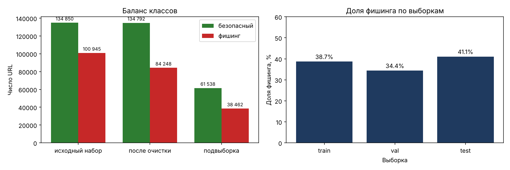
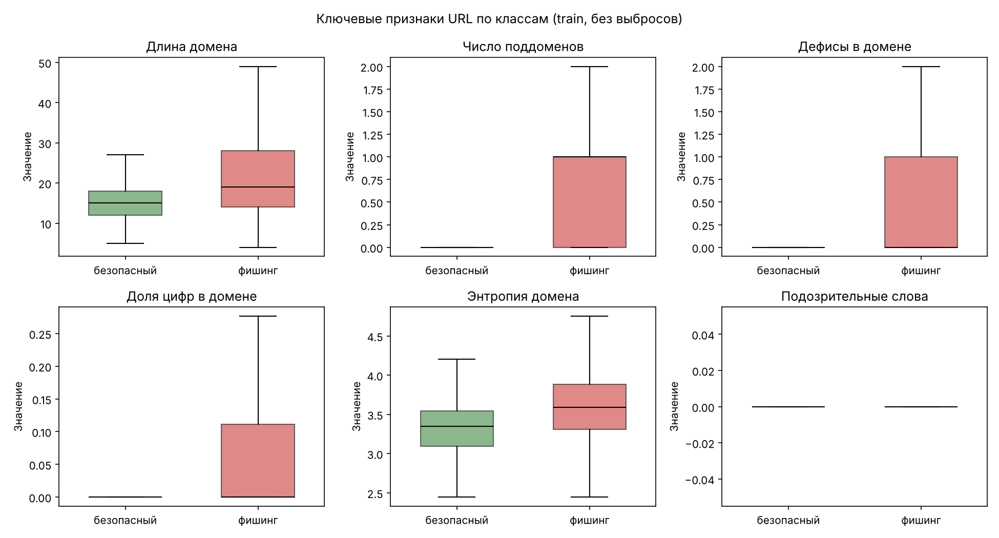

# Задание 10. Подготовка датасета URL

**Автор:** Омаров Марлен Еркешович, SIS-2304

Ноутбук: `notebooks/06_url_dataset.ipynb`. Скрипты: `python -m ml.data.download_urls` (загрузка),
`python -m ml.data.prepare_urls` (очистка, разбиение, признаки).

## 1. Паспорт набора

| № | Пункт | Значение |
| :-: | :--- | :--- |
| 1 | **Источник** | PhiUSIIL Phishing URL Dataset. Авторы: Arvind Prasad, Shalini Chandra. Статья: *PhiUSIIL: A diverse security profile empowered phishing URL detection framework based on similarity index and incremental learning*, Computers & Security, 2024 |
| 2 | **Ссылка** | <https://archive.ics.uci.edu/dataset/967> (UCI ML Repository, id 967), DOI статьи 10.1016/j.cose.2023.103545 |
| 3 | **Лицензия** | Creative Commons Attribution 4.0 International (CC BY 4.0) |
| 4 | **Дата загрузки** | 14.11.2026 (MD5 файла `dec0f871c39cda8f153e7450c479078c`) |
| 5 | **Язык / тип данных** | URL (строки) + 54 признака URL и страницы |
| 6 | **Объём** | 235 795 записей, 56 столбцов, файл 56 618 549 байт; пропусков нет |
| 7 | **Классы** | Исходно `label = 1` — легитимный (134 850), `0` — фишинг (100 945). В проекте метка инвертирована: 1 — фишинг, 0 — безопасный |
| 8 | **Ограничения** | Артефакт разметки (раздел 2); большинство признаков требует загрузки страницы и не используется; почти нет IP-адресов, Punycode и сокращателей |

Файл набора (≈ 54 МБ) в git не добавляется (`data/raw/url/` в `.gitignore`), его скачивает `download_urls`.

## 2. Структура и использованные столбцы

| Столбец | Тип | Используется |
| :--- | :--- | :--- |
| `URL` | строка | да — из неё функцией `ml.url_features` вычисляются признаки |
| `label` | 0/1 | да — целевая переменная (инвертируется) |
| `FILENAME` | строка | нет (по описанию набора не нужен) |
| `Domain`, `TLD`, `URLLength`, `IsHTTPS` и др. признаки URL | разные | нет — пересчитываются нашей функцией, как в приложении |
| `LineOfCode`, `HasTitle`, `NoOfImage`, `HasPasswordField` и др. | разные | нет — получены при загрузке страницы, а система страницы не загружает |

## 3. Артефакт разметки и его устранение

| Начало URL | Безопасные | Фишинг |
| :--- | --: | --: |
| `http://` | 0 | 12 452 |
| `http://www.` | 0 | 39 297 |
| `https://` | 0 | 46 747 |
| `https://www.` | **134 850** | 2 449 |

Все безопасные URL — главные страницы вида `https://www.домен` без пути; путь есть у 59,9% фишинговых. Правило «не
`https://www.` или есть путь → фишинг» без ML даёт accuracy 0,997. Модель, обученная на исходных строках, выучила бы
это правило и ошибалась бы на реальных ссылках (`https://kaspi.kz/shop`, `kaspi.kz`).

**Решение:** каждый URL приводится к канонической форме `http://домен[:порт]` (`ml.url_features.canonical_url`),
модель получает 17 признаков домена (`MODEL_FEATURES`). Признаки пути, схемы и `@` (`url_length`, `path_length`,
`path_depth`, `n_query_params`, `double_slash_path`, `has_at`, `is_https`) считаются и показываются пользователю
в объяснении, но в модель не входят. В приложении используется та же функция `model_features`.

## 4. Очистка и разбиение

| № | Шаг | Записей | Примечание |
| :-: | :--- | --: | :--- |
| 1 | Исходные записи | 235795 | PhiUSIIL, столбцы URL и label |
| 2 | Удалены пустые URL | 0 |  |
| 3 | Удалены некорректные URL | 8 | validate_url: пробелы, нет домена и т. п. |
| 4 | Удалены точные дубликаты URL | 425 |  |
| 5 | Каноническая форма http://домен | 235362 | схема, www., путь и запрос отброшены |
| 6 | Удалены домены с противоречивыми метками | 159 | 58 доменов |
| 7 | Удалены дубликаты доменов | 16163 | в основном фишинговые URL с разными путями на одном домене |
| 8 | Стратифицированная подвыборка | 100000 | до 100000 с сохранением доли фишинга (38.5%) |

| Выборка | Записей | Безопасных | Фишинг | Доля фишинга | Регистрируемых доменов |
| :--- | --: | --: | --: | --: | --: |
| train | 70098 | 42977 | 27121 | 38.69% | 56870 |
| val | 14052 | 9221 | 4831 | 34.38% | 12186 |
| test | 15850 | 9340 | 6510 | 41.07% | 12187 |

Общих регистрируемых доменов: train ∩ test — 0, train ∩ val — 0, val ∩ test — 0.

Разбиение — `GroupShuffleSplit` по регистрируемому домену (`tldextract`), `random_state = 42`. Индексы выборок —
`data/processed/url_split.json`; признаки — `data/processed/url_features.parquet` (без pyarrow — `.csv.gz`).

## 5. Выводы

1. **Набор:** 235 795 URL без пропусков, 134 850 безопасных (57,2%) и 100 945 фишинговых (42,8%) — точно как в описании UCI. Из 56 столбцов используются только `URL` и `label`; остальные признаки требуют загрузки страницы.
2. **Артефакт разметки найден и устранён.** Все безопасные URL имеют вид `https://www.домен` без пути; правило «не `https://www.` или есть путь → фишинг» без всякого ML даёт accuracy 0,997 при нуле ложных тревог. URL приведены к канонической форме `http://домен`, модель получает только 17 признаков домена.
3. **Очистка:** 8 некорректных URL, 425 точных дубликатов, 58 доменов с противоречивыми метками (159 записей), 16 163 дубликата доменов (фишинговые URL с разными путями на одном домене). Осталось 219 040 доменов, из них стратифицированная подвыборка — 100 000 (38,5% фишинга).
4. **Разбиение по регистрируемому домену:** train 70 098, val 14 052, test 15 850; общих доменов между выборками нет. Доля фишинга по выборкам 34–41%: крупные хостинги попадают в одну выборку целиком (весь `firebaseapp.com` — в test), поэтому test проверяет распознавание фишинга на незнакомом хостинге.
5. **Признаки по классам (train):** у фишинговых доменов больше поддоменов (0,72 против 0,03 в среднем), цифр (2,08 против 0,05), дефисов (0,58 против 0,08), они длиннее (22,4 против 15,2 символа); подозрительная зона — у 9,4% фишинговых и 0,06% безопасных, название бренда в чужом домене — 1,5% против 0,1%.
6. **Ограничения.** IP-адреса (0,23%), Punycode (0,18%) и сокращатели ссылок (единицы) в наборе почти не встречаются, поэтому модель их практически не выучит; эти случаи дополнительно учитывают правила модуля риска (задание 13). Безопасные URL в наборе — главные страницы популярных сайтов, поэтому модель может хуже оценивать безопасные адреса малоизвестных сайтов.
