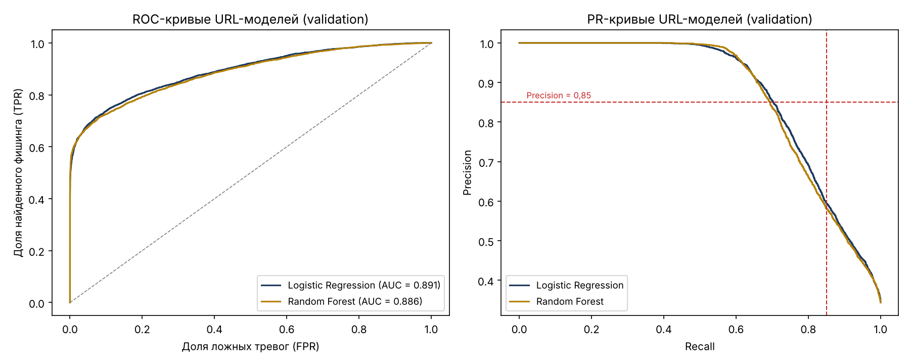
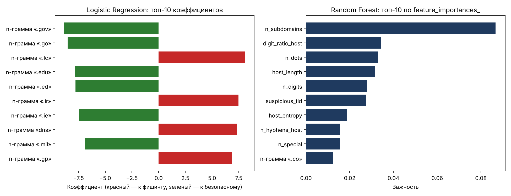
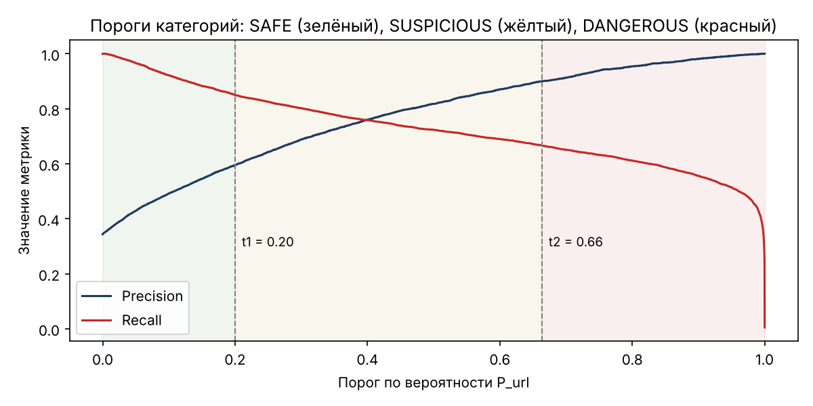
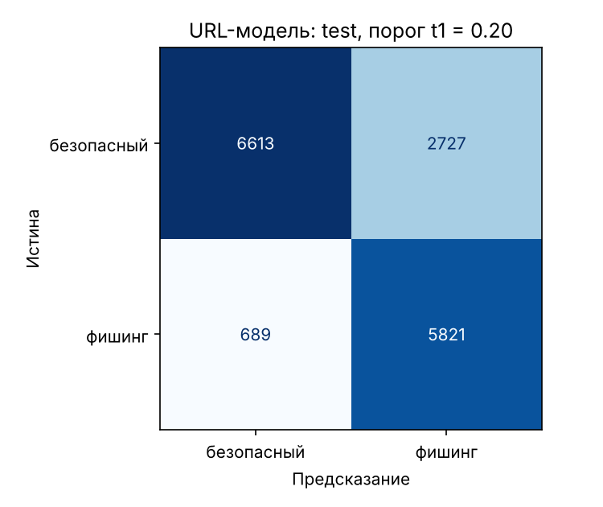

# Задание 11. Модель обнаружения опасных ссылок

**Автор:** Омаров Марлен Еркешович, SIS-2304

Ноутбук: `notebooks/07_url_models.ipynb`. Без ноутбука: `python -m ml.train_url`.
Модель: `ml/artifacts/url_model.joblib` + `url_model_meta.json` (версия 1.0.0). Результаты сравнения: `ml/artifacts/url_comparison.json`.

## 1. Методика

| Шаг | Как сделано |
| :--- | :--- |
| Данные | 100 000 URL PhiUSIIL (задание 10): train 70 098, validation 14 052, test 15 850; разбиение по регистрируемому домену |
| Признаки | 17 числовых признаков канонического домена + символьные 2–5-граммы домена (TF-IDF). Вход — `ml.url_features.model_input(url)`, та же функция работает в приложении |
| Алгоритмы | Logistic Regression (StandardScaler + TF-IDF), Random Forest (200 деревьев, 3000 самых частых n-грамм) |
| Подбор | `GridSearchCV`, 3 фолда `StratifiedGroupKFold` по домену, метрика F2. LR: `C` 0,3–10; RF: `min_samples_leaf` 2/5 |
| Пороги | На validation: t1 — максимальный порог с Recall ≥ 0,85; t2 — минимальный порог с Precision ≥ 0,90 |
| Категории | `SAFE`: P < t1; `SUSPICIOUS`: t1 ≤ P < t2; `DANGEROUS`: P ≥ t2 |

## 2. История версий (для честности оценки)

| Версия | Что изменилось | Validation ROC-AUC | Test (оценивался) |
| :--- | :--- | --: | :--- |
| 1 | 17 числовых признаков домена; пороги Recall ≥ 0,95 / Precision ≥ 0,95 | 0,813 | ROC-AUC 0,858; при t1 Precision 0,451, Recall 0,959 |
| 2 | + символьные n-граммы домена (решение принято по validation) | 0,891 | ROC-AUC 0,921; при t1 = 0,068 Precision 0,530, Recall 0,963 |
| **3 (итог)** | пороги пересмотрены по validation: t1 по Recall ≥ 0,85, t2 по Precision ≥ 0,90 | 0,891 | см. раздел 4 |

Версия 1 не достигала ROC-AUC 0,90 уже на validation — это и стало причиной добавить n-граммы. Пороги версии 2 относили к
SUSPICIOUS 60% безопасных доменов validation (5518 из 9221), что тоже видно без test. Обе доработки сделаны по validation,
но test к тому моменту уже оценивался, поэтому все версии приведены здесь.

## 3. Сравнение алгоритмов (validation)

| Алгоритм | Параметры | CV F2 | ROC-AUC | PR-AUC | t1 | t2 | Precision @t1 | Recall @t1 | F2 @t1 | Обучение, с | Предсказание, мс |
| :--- | :--- | --: | --: | --: | --: | --: | --: | --: | --: | --: | --: |
| **Logistic Regression** | C = 10 | 0,780 | **0,891** | **0,872** | 0,200 | 0,664 | 0,595 | 0,850 | **0,783** | 81 | **3,0** |
| Random Forest | min_samples_leaf = 5 | 0,738 | 0,886 | 0,867 | 0,276 | 0,508 | 0,582 | 0,850 | 0,779 | 365 | 43,9 |

Выбрана **Logistic Regression**: качество не хуже, предсказание в 14 раз быстрее, коэффициенты интерпретируемы.

## 4. Test (итоговая модель)

| Порог | Precision | Recall | F1 | F2 | Accuracy | ROC-AUC | PR-AUC | TN | FP | FN | TP |
| :--- | --: | --: | --: | --: | --: | --: | --: | --: | --: | --: | --: |
| t1 = 0,200 | 0,681 | 0,894 | 0,773 | 0,842 | 0,785 | 0,921 | 0,921 | 6613 | 2727 | 689 | 5821 |
| 0,5 | 0,878 | 0,792 | 0,833 | 0,808 | 0,870 | 0,921 | 0,921 | 8626 | 714 | 1355 | 5155 |
| t2 = 0,664 | 0,935 | 0,744 | 0,829 | 0,776 | 0,874 | 0,921 | 0,921 | — | — | — | — |

| Категория | Безопасных | Фишинговых |
| :--- | --: | --: |
| SAFE | 6613 | 689 |
| SUSPICIOUS | 2389 | 975 |
| DANGEROUS | 338 | 4846 |

**Требования раздела 3.4** (Recall ≥ 0,85, Precision ≥ 0,85, ROC-AUC ≥ 0,90): ROC-AUC выполнено (0,921);
одновременно Precision и Recall ≥ 0,85 при одном пороге не достигаются (при 0,5 — 0,878 / 0,792).

## 5. Анализ ошибок и проверка на 20 URL

**Пропущенный фишинг** — домены, похожие на обычные сайты (`sen.org.nz`, `openairradio.hu`, `bowsbride.co.uk`). По-видимому,
это взломанные легитимные сайты с размещённой фишинговой страницей: по строке домена их не отличить.
**Ложные тревоги** — поддомены крупных компаний (`support.xerox.com`, `observatorio-empresas.vodafone.es`) и домены со
«словами риска» (`okcoin.com`, `glue.work`).

**20 искусственных URL:** все 10 подозрительных распознаны (9 — DANGEROUS, `paypa1.example` — SUSPICIOUS). Из 10 безопасных
5 получили SAFE; `kaspi.kz`, `halykbank.kz`, `google.com`, `github.com`, `microsoft.com` — SUSPICIOUS (P = 0,26–0,57).
Поэтому в приложении действует **список официальных доменов** (`risk_config.yaml`, `trusted_domains`): ссылка на точный
официальный домен получает SAFE. Это правило, а не модель; похожие домены (`kaspl.kz`) под него не попадают.

## 6. Выводы

1. Сравнено 2 алгоритма; выбрана Logistic Regression (ROC-AUC 0,891 на validation, 0,921 на test, 3 мс на URL).
2. Пороги t1 = 0,200 и t2 = 0,664 подобраны на validation и записаны в метаданные.
3. ROC-AUC соответствует требованию; Precision и Recall ≥ 0,85 одновременно не достигаются. Главная причина — модель видит
   только строку домена (страницы не загружаются, артефакт разметки устранён), а часть фишинга размещена на взломанных
   легитимных доменах.
4. Улучшения: внешние данные о домене (возраст, репутация — ФТ-3.11), безопасные URL с путями и малоизвестных сайтов в
   обучении, отдельная обработка поддоменов хостингов.
