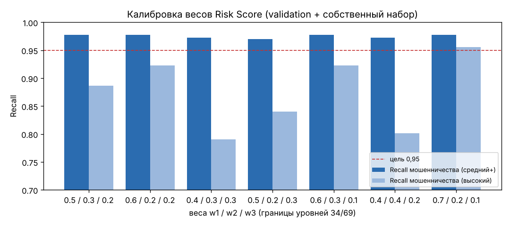
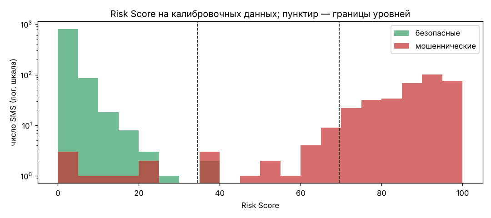

# Задание 13. Алгоритм оценки риска

**Автор:** Омаров Марлен Еркешович, SIS-2304

Код: `ml/risk.py`. Параметры: `risk_config.yaml`. Калибровка: `ml/calibrate_risk.py`, `notebooks/08_risk_calibration.ipynb`.
Тесты: `tests/test_risk.py` (24 теста).

## 1. Формула

$$\text{RiskScore} = 100 \cdot \frac{w_1 P_{sms} + w_2 P_{url,max} + w_3 S_{se}}{w_1 + w_2 \cdot [\text{URL есть}] + w_3}, \quad S_{se} = \min\left(\frac{k}{3}, 1\right)$$

- $P_{sms}$ — вероятность мошенничества по SMS-модели (задание 8);
- $P_{url,max}$ — максимальная вероятность опасности среди ссылок сообщения (задание 11); ссылка на официальный домен из
  списка `trusted_domains` даёт 0; если ссылок нет, слагаемое $w_2$ исключается из числителя и знаменателя;
- $k$ — число сработавших групп социальной инженерии (`ml/rules.py`, 6 групп) плюс `LINK_REQUEST` (просьба перейти по ссылке).

Итоговые веса после калибровки: **$w_1 = 0{,}6$, $w_2 = 0{,}2$, $w_3 = 0{,}2$** (начальные по ТЗ — 0,5 / 0,3 / 0,2).

**Правила усиления** (после формулы, `overrides` в конфиге):

| Правило | Условие | Минимальный Risk Score |
| :--- | :--- | --: |
| `CODE_REQUEST` | сработала группа «запрос кода/пароля» | 70 |
| `SMS_AND_URL_HIGH` | $P_{sms} \ge 0{,}8$ и $P_{url,max} \ge t_2$ (0,664) | 85 |
| `IP_OR_PUNYCODE` | ссылка содержит IP-адрес или Punycode (`xn--`) | 60 |

**Уровни и категории:** 0–34 — низкий → `SAFE`; 35–69 — средний → `SUSPICIOUS`; 70–100 — высокий → `FRAUDULENT`.

**Отдельная ссылка** (`/check/url/`): $P_{url}$ переводится в шкалу 0–100 кусочно-линейно так, что порог $t_1$ → 35,
$t_2$ → 70 (границы уровней), затем применяется правило `IP_OR_PUNYCODE`. Категории ссылки: `SAFE` / `SUSPICIOUS` / `DANGEROUS`.

## 2. Объяснение и рекомендация

Каждое срабатывание даёт строку причины на русском: вероятность модели > 0,5, каждая группа словаря (с найденной фразой),
каждый флаг ссылки (подозрительные слова, Punycode, IP, сокращатель, сходство с брендом и т. д.), применённое правило
усиления. Причины сортируются по вкладу в формулу (вес × значение; `CODE_REQUEST` и правила усиления — первыми),
выводится не более 6. Если ничего не сработало — одна строка «Явных признаков мошенничества не обнаружено», т. е. причина
есть всегда. Рекомендация берётся из `recommendations` (`low` / `medium` / `high`) или `url_recommendations`; во всех
результатах — предупреждение «Оценка носит вероятностный характер и не гарантирует безопасность».

Пример (демонстрационное сообщение № 5, Risk Score 100, высокий):
1. Текст похож на мошеннические сообщения (вероятность по SMS-модели 1.00)
2. Ссылка в сообщении похожа на опасную (вероятность по URL-модели 1.00)
3. secure-bank-verify.example: подозрительные слова в адресе: bank, login, secure, verify
4. secure-bank-verify.example: много дефисов в домене
5. secure-bank-verify.example: соединение без шифрования (HTTP, а не HTTPS)
6. Требование срочного действия: «срочн»

## 3. Калибровка

**Данные:** validation SMS (770 en, 185 ru, 182 kk) + собственный набор (100 ru, 50 kk) — 1287 SMS. $P_{sms}$ — модель
итоговой конфигурации, **обученная только на train** (итоговая модель дообучена на train + validation и дала бы на
validation завышенные вероятности). Test в калибровке не участвует.

**Цель ТЗ:** Recall мошеннических по уровню «средний и выше» ≥ 0,95; доля безопасных на уровне «высокий» < 3%.

Перебор: 7 вариантов весов × 5 вариантов границ (34/69, 29/69, 24/69, 34/64, 29/59). Таблица для границ ТЗ 34/69
(полная таблица из 35 строк — в ноутбуке):

| Веса w1 / w2 / w3 | Recall (средний+) | Recall (высокий) | Доля ложных высоких | Доля безопасных средний+ | Цель |
| :--- | --: | --: | --: | --: | :---: |
| 0,5 / 0,3 / 0,2 (начальные) | 0,978 | 0,887 | 0% | 0,22% | да |
| **0,6 / 0,2 / 0,2 (выбран)** | **0,978** | **0,923** | **0%** | **0,22%** | **да** |
| 0,4 / 0,3 / 0,3 | 0,972 | 0,790 | 0% | 0,22% | да |
| 0,5 / 0,2 / 0,3 | 0,970 | 0,840 | 0% | 0,22% | да |
| 0,6 / 0,3 / 0,1 | 0,978 | 0,923 | 0% | 0,22% | да |
| 0,4 / 0,4 / 0,2 | 0,972 | 0,801 | 0% | 0,22% | да |
| 0,7 / 0,2 / 0,1 | 0,978 | 0,956 | 0% | 0,22% | да |

Цель достигают все 35 вариантов, поэтому до проверки на test было зафиксировано **правило выбора**:
1) цель ТЗ выполнена; 2) границы ТЗ 34/69 сохраняются (их видит пользователь); 3) вес словаря $w_3 \ge 0{,}2$ — словарь не
зависит от SMS-модели, а для ru/kk модель проверена только на искусственных сообщениях; 4) минимальная доля безопасных
на уровне «средний+», затем максимальный Recall уровня «высокий». Без п. 3 был бы выбран 0,7 / 0,2 / 0,1.

**По языкам (калибровочные данные, выбранный вариант):**

| Набор | Язык | SMS | Recall (средний+) | Recall (высокий) | Ложные высокие | Безопасные средний+ |
| :--- | :--- | --: | --: | --: | --: | --: |
| validation | en | 770 | **0,925** | 0,796 | 0% | 0,3% |
| validation | kk | 182 | 1,000 | 1,000 | 0% | 0% |
| validation | ru | 185 | 1,000 | 0,990 | 0% | 0% |
| собственный | kk | 50 | 1,000 | 0,960 | 0% | 0% |
| собственный | ru | 100 | 0,980 | 0,860 | 0% | 0% |

Для английской части отдельно цель по Recall не достигнута: пропущены спам-сообщения без признаков мошенничества
(реклама, знакомства, «For sale – arsenal dartboard»), у которых $P_{sms} < 0{,}1$ и нет групп словаря.

## 4. Проверка на test (однократно, после выбора)

Итоговая SMS-модель (`sms_model.joblib`), как в приложении:

| Язык | SMS | Recall (средний+) | Recall (высокий) | Ложные высокие | Безопасные средний+ |
| :--- | --: | --: | --: | --: | --: |
| все | 1146 | **0,972** | 0,920 | **0,8%** | 3,7% |
| en | 771 | 0,914 | 0,774 | 0% | 0,4% |
| kk | 188 | 1,000 | 0,980 | **7,8%** | 14,4% |
| ru | 187 | 1,000 | 1,000 | 0% | **18,0%** |

Для набора в целом цель выполнена. На искусственных казахских и русских безопасных SMS доля ложных срабатываний выше —
это ошибки SMS-модели на шаблонах доставки с номером телефона и акций со ссылкой (задание 8). Веса формулы их не
исправляют: нужны дополнительные безопасные обучающие примеры этих типов.

## 5. Демонстрационные сообщения (раздел 8.3, фактические результаты)

| № | Язык | P_sms | P_url,max | Группы | Risk Score | Уровень | Категория |
| --: | :--- | --: | --: | :--- | --: | :--- | :--- |
| 1 | ru | 0,001 | — | — | 0 | низкий | SAFE |
| 2 | en | 0,014 | — | — | 1 | низкий | SAFE |
| 3 | kk | 0,000 | — | — | 0 | низкий | SAFE |
| 4 | ru | 0,002 | — | — | 0 | низкий | SAFE |
| 5 | ru | 1,000 | 0,999 | URGENCY, BANK_CARD, ACCOUNT_BLOCK, LINK_REQUEST | 100 | высокий | FRAUDULENT |
| 6 | en | 1,000 | 1,000 | URGENCY, BANK_CARD, ACCOUNT_BLOCK, LINK_REQUEST | 100 | высокий | FRAUDULENT |
| 7 | ru | 0,642 | — | URGENCY, MONEY_TRANSFER | 65 | средний | SUSPICIOUS |
| 8 | en | 1,000 | 1,000 | BANK_CARD, PRIZE, LINK_REQUEST | 100 | высокий | FRAUDULENT |
| 9 | ru | 0,993 | — | BANK_CARD, ACCOUNT_BLOCK, CODE_REQUEST | 100 | высокий | FRAUDULENT |
| 10 | kk | 1,000 | 0,988 | URGENCY, BANK_CARD, ACCOUNT_BLOCK, LINK_REQUEST | 100 | высокий | FRAUDULENT |
| 11 | ru | 0,549 | 0,945 | — | 52 | средний | SUSPICIOUS |
| 12 | URL | — | 0,025 | — | 4 | низкий | SAFE |
| 13 | URL | — | 1,000 | — | 100 | высокий | DANGEROUS |

Сообщение № 7 («Мама… никому не говори») получило средний уровень: группы секретности в словаре нет, $P_{sms} = 0{,}64$.

## 6. Тесты и конфигурация

`tests/test_risk.py`: границы 34/35 и 69/70 (уровни и категории), формула без URL и с URL, насыщение $S_{se}$, каждое
правило усиления и случай, когда счёт уже выше минимума, все признаки сразу, ≥ 1 причина и рекомендация в каждом
результате, сортировка и лимит 6 причин, шкала отдельной ссылки (t1 → 35, t2 → 70), **изменение `risk_config.yaml`
меняет результат без правки кода** (конфиг перечитывается по времени изменения файла).

## 7. Выводы

1. Формула, правила усиления, уровни, причины и рекомендации реализованы и описаны; все параметры — в `risk_config.yaml`.
2. Веса подобраны на validation и собственном наборе: 0,6 / 0,2 / 0,2 при границах ТЗ; цель достигнута на калибровочных
   данных (Recall 0,978, ложных высоких 0%) и на test в целом (0,972 и 0,8%).
3. Ограничения: английский спам рекламного типа часто получает низкий уровень (Recall en 0,91–0,93); у искусственных ru/kk
   безопасных SMS заметная доля ложных «средних» и «высоких» уровней. Улучшения — группа `SECRECY` в словаре и больше
   безопасных ru/kk примеров для SMS-модели.
