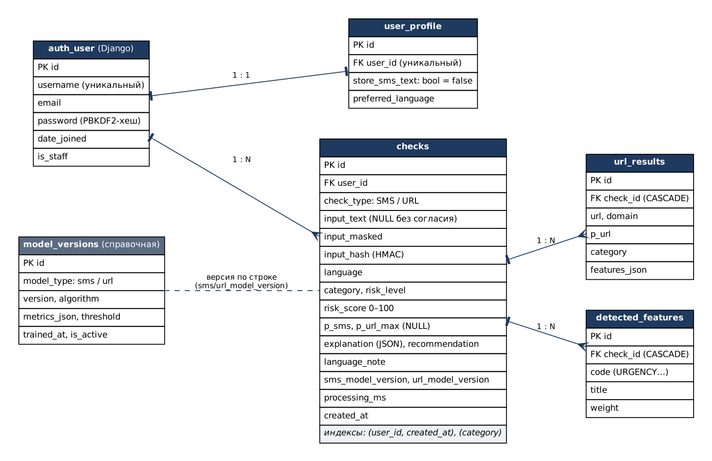

# Задание 16. База данных и история проверок

**Автор:** Омаров Марлен Еркешович, SIS-2304

## 1. Модели и миграции

| Таблица | Модель | Файл |
| :--- | :--- | :--- |
| `auth_user` | встроенная модель Django (пароль — PBKDF2 с солью) | — |
| `user_profile` | `UserProfile` (`store_sms_text` = false по умолчанию, `preferred_language`); создаётся сигналом при регистрации | `apps/accounts/models.py` |
| `checks` | `Check` | `apps/analysis/models.py` |
| `url_results` | `UrlResult` (FK `check_id`, `on_delete=CASCADE`) | |
| `detected_features` | `DetectedFeature` (FK `check_id`, `on_delete=CASCADE`) | |
| `model_versions` | `ModelVersion` — заполняется из метаданных моделей при первой проверке, активная версия помечается `is_active` | |

Индексы: `checks (user_id, created_at)`, `checks (category)`. Миграции `apps/accounts/migrations/0001_initial.py`,
`apps/analysis/migrations/0001_initial.py` применяются с нуля (`python manage.py migrate`; проверено на SQLite,
в тестах — на чистой БД). Дополнительно к разделу 4.3: `input_hash` (HMAC для защиты от повторной отправки),
`p_url_max`, `language_note`, `processing_ms`.



Исходник диаграммы — `docs/diagrams/er_diagram.dot` (Graphviz): `dot -Tpng docs/diagrams/er_diagram.dot -o docs/figures/16_er_diagram.png`.

## 2. Сохранение и маскирование

`apps/analysis/storage.py → save_result()` сохраняет проверку, ссылки и признаки **в одной транзакции**
(`transaction.atomic`): при ошибке не остаётся «половины» записи.

`apps/analysis/masking.py → mask_text()`:

| Что | Пример до | После |
| :--- | :--- | :--- |
| Номер карты (13–19 цифр, с пробелами/дефисами) | `Карта 4400 4301 2345 6789 заблокирована` | `Карта *** заблокирована` |
| Телефон (+7 / 8 / код страны, 10–12 цифр) | `Позвоните +7 701 123 45 67` | `Позвоните ***` |
| Сумма (с валютой или с разделителем тысяч) | `Переведи 50 000`, `350 T`, `$1000` | `Переведи ***`, `***`, `***` |
| Не маскируется | коды `4821`, время `18:00`, IP в ссылке `192.0.2.15` | без изменений |

Без согласия (`store_sms_text = false`): `input_text = NULL`, хранится только `input_masked`; адреса ссылок
тоже маскируются. Флажок согласия — в профиле. Проверено тестами `test_text_not_stored_without_consent`,
`test_text_stored_with_consent`, `test_mask_text` (9 случаев).

## 3. Страницы

- **История** (`/history/`): таблица «Дата, Тип, Фрагмент (до 60 символов), Уровень, Risk Score, Результат (бейдж)»,
  сортировка — новые сверху, пагинация по 20 («Показано 1–20 из 38», номера страниц с многоточием).
  Фильтры: даты «С / По», тип, категория, уровень, кнопки «Применить» и «Сбросить»; **состояние фильтров — в адресной
  строке** (`?date_from=…&type=SMS&category=SAFE&page=2`), ссылки пагинации сохраняют фильтры. Клик по строке открывает
  подробный результат. Неверный параметр — сообщение на русском над таблицей, без ошибки 500.
- **Подробный результат** (`/checks/<id>/`) и **удаление** (`/checks/<id>/delete/`): GET показывает страницу
  подтверждения, удаляет только POST с CSRF-токеном.
- **Профиль** (`/profile/`): данные пользователя, переключатель согласия, смена пароля (старый + новый ×2, те же
  правила сложности; сессия сохраняется), «Удалить всю мою историю» (нужно отметить флажок подтверждения).

Все запросы ограничены владельцем: `get_object_or_404(Check, pk=pk, user=request.user)` → чужая запись даёт 404
и не удаляется (`test_foreign_detail_and_delete_404`).

## 4. Демонстрационные данные

```bash
python manage.py seed_demo                 # demo_user / DemoPass2026, 30 проверок
python manage.py seed_demo --password Другой2026   # свой пароль
```

Команда создаёт (или обновляет) пользователя `demo_user`, удаляет его прежние проверки и выполняет 30 проверок:
11 демонстрационных SMS раздела 8.3, 16 случайных SMS собственного набора (задание 3) и 3 URL. Результаты считают
обученные модели во время запуска; даты распределены по последним 30 дням. Демо-пользователю включено согласие на
хранение текста (все тексты искусственные); его можно выключить в профиле. Фактический результат запуска:
`SAFE 14, SUSPICIOUS 2, FRAUDULENT 12, DANGEROUS 2`.

## 5. Проверка критериев

| Критерий | Проверка | Результат |
| :--- | :--- | :--- |
| Фильтры дают корректную выборку | `test_history_filters_in_query_string`, `test_history_list_filters_and_pagination` (API) | пройдено |
| Без согласия полный текст не сохраняется | `test_text_not_stored_without_consent` | пройдено |
| Чужие записи не видны и не удаляются | `test_foreign_detail_and_delete_404`, `test_foreign_record_returns_404` | пройдено |
| Пагинация по 20 | `test_history_pagination_20` (23 записи → 20 + 3) | пройдено |
| Каскадное удаление | `test_detail_and_delete_own` | пройдено |
| `seed_demo` — 30 проверок, повторный запуск без дублей | `test_seed_demo_creates_30_checks` | пройдено |
