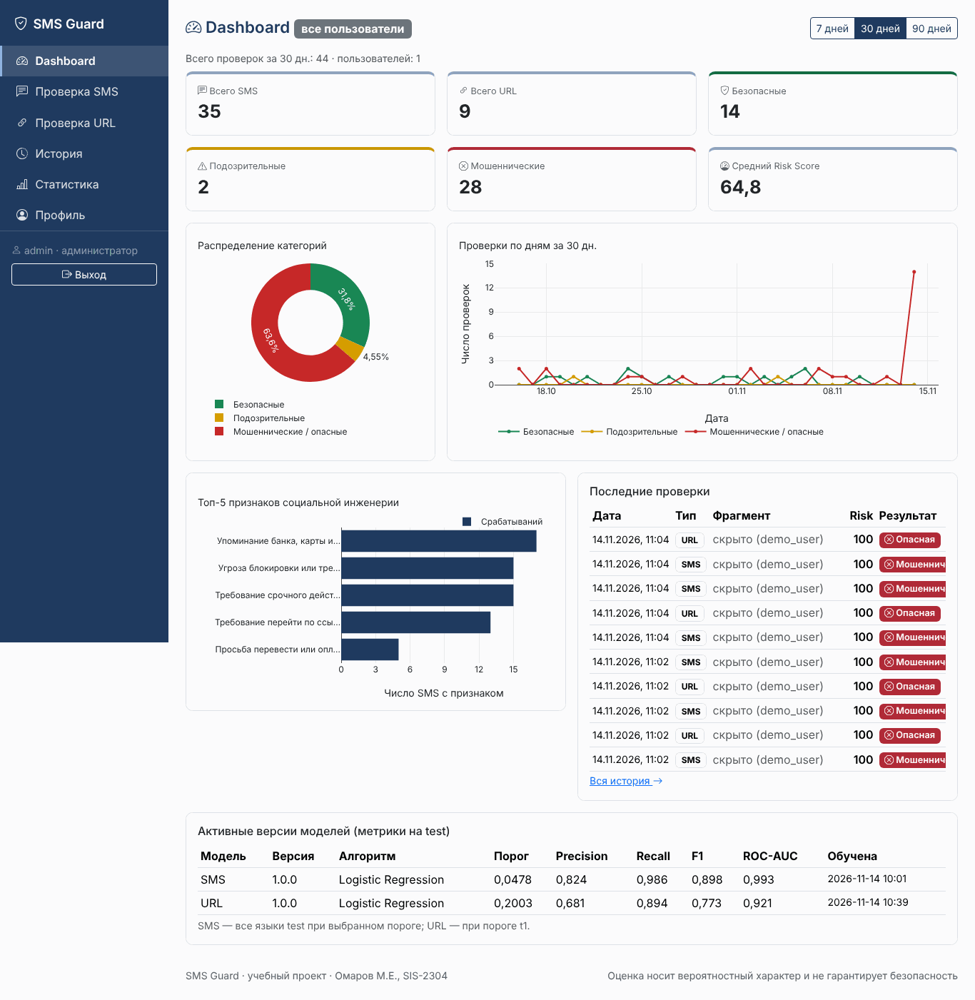
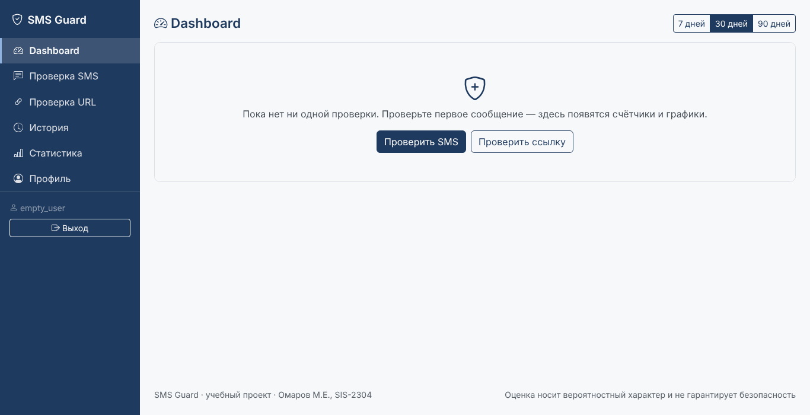

# Задание 17. Панель мониторинга

**Автор:** Омаров Марлен Еркешович, SIS-2304

Страницы `/` (Dashboard) и `/stats/` (расширенная статистика). Данные — `GET /api/v1/stats/summary/?days=7|30|90`
(`apps/analysis/stats.py`), графики — **Plotly.js** (`plotly-basic`, локальная копия в `static/vendor/plotly`,
лицензия MIT), код отрисовки — `static/js/dashboard.js`.

## 1. Состав

| № | Требование | Реализация |
| :--: | :--- | :--- |
| 1 | Карточки | Всего SMS, Всего URL, Безопасные, Подозрительные, Мошеннические (вместе с опасными ссылками), Средний Risk Score; над карточками — общее число проверок за период |
| 2 | Кольцевая диаграмма категорий | `pie` с `hole: 0.55`, проценты на секторах, легенда |
| 3 | Проверки по дням за период по категориям | Dashboard — линейный график (3 линии); `/stats/` — столбцы с накоплением. Дни без проверок показываются нулём |
| 4 | Топ-5 признаков социальной инженерии | горизонтальные столбцы; длинные названия сокращены, полное — во всплывающей подсказке |
| 5 | Последние 10 проверок | таблица с бейджами и ссылкой на подробный результат |
| 6 | Период 7 / 30 / 90 дней | переключатель перерисовывает графики без перезагрузки и сохраняет `?days=` в адресной строке |
| 7 | Агрегация в БД | `aggregate(Count(filter=Q(...)), Avg)`, `annotate(day=TruncDate("created_at")).values("day").annotate(Count…)`, топ признаков — `values("code","title").annotate(Count)`. Python-циклов по записям нет |
| 8 | Администратор | `is_staff` видит данные по всем пользователям (метка «все пользователи», число пользователей) и блок «Активные версии моделей» (версия, алгоритм, порог, Precision/Recall/F1/ROC-AUC на test, дата обучения). Тексты чужих проверок скрыты: «скрыто (логин)», ссылка на чужую запись не выводится (ФТ-1.9) |
| 9 | Пустое состояние | «Пока нет ни одной проверки…» и кнопки «Проверить SMS» / «Проверить ссылку» |
| 10 | Обновление после проверки | данные запрашиваются при каждом открытии страницы, кэширования нет |

У каждого графика есть заголовок, подписи осей (для столбцов и линий) и легенда; у контейнеров графиков —
`role="img"` и текстовое описание для экранных дикторов. Цвета категорий совпадают с бейджами и дополнены подписями.

## 2. Проверка критериев (фактические результаты)

**Числа на карточках совпадают с выборкой из БД** — тест `test_stats_cards_match_db`: после `seed_demo` значения
`total`, `safe`, `fraud`, `url`, сумма уровней сравниваются с `Check.objects.filter(...).count()` — пройден.
`test_stats_summary` проверяет, что сумма точек графика по дням равна числу проверок.

**Производительность (НФТ-2)**, 1000 проверок одного пользователя за 90 дней (SQLite, ноутбук-сервер разработки):

| Замер | Время |
| :--- | --: |
| `GET /api/v1/stats/summary/?days=7` (67 записей в периоде) | 6 мс |
| `GET /api/v1/stats/summary/?days=30` (318 записей) | 8 мс |
| `GET /api/v1/stats/summary/?days=90` (1000 записей) | 14 мс |
| Полная загрузка Dashboard в Chrome до отрисовки всех графиков и таблицы (90 дней) | 0,24–0,28 с |
| Страница истории, 25-я страница | 9 мс |

Требование «не более 2 с» выполнено с запасом. Сохранение 1000 проверок заняло 10,8 с (анализ одного SMS — в среднем
6,9 мс, 95-й процентиль 10,8 мс; НФТ-1 — не более 500 мс).

## 3. Скриншоты

Пользователь (демо-данные): `figures/15_home_1366.png`, `15_home_768.png`, `15_home_360.png`; статистика —
`15_stats_*.png`.

Администратор:

Пустое состояние:

